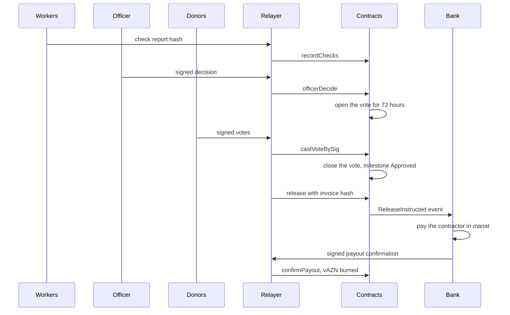

# Veritas architecture

This is how Veritas is put together: the parts of the system, the technology, exactly what goes on the blockchain and what does not, and how money and evidence travel from a donor to a contractor. When the design changes, this file changes with it.

## 1. Goals and constraints

- **Donors should not have to trust us.** Every promise, donation, decision and payout has to be checkable from public data, without asking Veritas.
- **No crypto in the donor's face.** Donors pay by card in manat. They never need a wallet, never pay gas and never see a token.
- **Money stays in a bank.** Crypto escrow has no clear legal basis in Azerbaijan yet. The manat sits in an escrow account at a licensed partner bank. The blockchain holds the rules and the record, and tells the bank when money may move.
- **Nothing personal on-chain.** The chain gets hashes, amounts and decisions. Names, phone numbers, card data, faces and bank accounts stay off it.
- **Evidence stays on our servers.** Photos and invoices are analysed with local models. Nothing is sent to an outside AI service.
- **AI advises, humans decide, the chain enforces.** No model output can release money.

## 2. System overview


Thick arrows call or write. Dotted arrows only read.

**Web app.** A website rather than a phone app, so nobody has to install anything to give or to raise money. Donors give, track, vote and choose refunds or redirects. Charities apply and run their projects, and their field staff capture evidence. Verification Officers, the independent reviewers named in each Passport (an audit firm or a partner organisation, for example), review and sign. The app only talks to our API and never calls the chain, but it holds the user's own signing key (section 5). People sign up with an email and a password, which the API checks itself: salted scrypt hashes, a lock after too many wrong passwords in a row, and one-time links by email to set a new one. Or they continue with Google: Firebase signs them in to Google and the app trades the Firebase ID token for one of our session tokens at `POST /v1/auth/firebase`, where the API checks Google's signature, our project and the expiry. Firebase is not used for anything else, so the whole system runs on our own servers. The one other outside service the website uses is the assistant: questions about how Veritas works go through our API to an OpenAI model, which sees only a fixed description of Veritas, has no tools and no data, and is rate-limited per visitor and per day. The signing key and evidence capture were designed for a phone; how they work in a browser is an open question (section 13).

**API.** A FastAPI service for accounts, Passports, donations, evidence intake, votes, timelines and the impact map.

**PostgreSQL.** The main database. PostGIS holds project sites and geofences. The same database runs the job queue and the outbox for chain writes, and keeps a copy of every contract event.

**Workers.** Background jobs: the evidence pipeline, hourly donation batches, Pay-on-Proof charges, daily reconciliation and push notifications.

**Ollama.** Serves a vision model and a text model on our own hardware.

**Storage.** Original evidence goes to private S3-compatible storage. A redacted public copy goes to our IPFS node and is pinned by an independent provider as well, so it survives even if we don't.

**Relayer.** The only process that sends transactions, and the one that pays the gas. On its own it cannot release money, vote or confirm a payout (section 5).

**Indexer.** Reads contract events from finalised blocks into PostgreSQL, so timelines load fast. Every status still links to its transaction on the public explorer.

**Card provider.** Takes card payments, keeps saved cards for Pay-on-Proof and handles refunds.

**Partner bank.** Holds the escrow account, pays contractors, and signs deposits, payouts and the daily balance with its own key. Ideally it is also the card acquirer, so it sees every payment as it happens. In the demo this is a small MockBank service with its own key.

**Public verifier.** A static page that checks a receipt against the chain and IPFS through public endpoints. It never calls our API, so it still tells the truth if our servers are down or lying. Anyone can host a copy.

## 3. Tech stack

| Area | Choice | Why |
| - | - | - |
| Assistant | An OpenAI model (gpt-4.1-mini by default) called by our API | Visitors' questions answered at once. The key stays on the server; the model gets no tools and no data, so nothing private can leak. |
| Web app | React 18, TypeScript, Vite, Tailwind CSS; Firebase only for Google sign-in | Nothing to install, one codebase for phones and computers. Passwords are checked by our own API, which trusts only its own session tokens. |
| API | Python 3.12, FastAPI, Pydantic v2 | One language for the API, the evidence checks and the models. Pydantic models double as the JSON schema the AI has to follow. |
| Database | PostgreSQL 17 with PostGIS, SQLAlchemy 2, Alembic | One database for data, geofences, jobs and the chain outbox. |
| Jobs | A small scheduler in `veritas.workers`, then Procrastinate | Periodic jobs in one process, one copy at a time through PostgreSQL advisory locks. Procrastinate (a queue on PostgreSQL, no Redis) comes in when jobs need queues and retries of their own. |
| Image checks | Pillow, OpenCV, imagehash, c2pa-python | Hashes, perceptual hashes, metadata and content credentials. |
| OCR | Tesseract 5 with Azerbaijani, Russian and English | Runs locally and reads Azerbaijani Latin script. |
| AI | Ollama with a vision model (Qwen2.5-VL 7B or Gemma 3 12B to start) and a text model | Local, cheap per check, JSON output that follows a schema. We pick the final models after testing on our own samples. |
| Storage | Private S3-compatible bucket, IPFS (Kubo) plus a second pinning provider | Private originals, public copies anyone can check. |
| Contracts | Solidity 0.8, OpenZeppelin Contracts 5, Foundry | Audited building blocks and fast tests with fuzzing. |
| Chain access | web3.py | The relayer and the indexer stay in Python. |
| Network | Polygon Amoy for the demo, Polygon PoS for production | Public EVM chain, fees well under a cent, mature explorers. Base would work the same way. |
| Maps | MapLibre with OpenStreetMap data | Impact map without a paid map API. |
| PDFs | WeasyPrint | Receipts for tax and CSR reporting. |
| Tooling | uv, Ruff, pytest, Docker Compose | Simple and fast. |

A few of these need a reason.

**PostgreSQL as the job queue.** Every chain write starts as a row in an outbox table, written in the same transaction as the change that caused it. If that transaction commits, the chain write will happen exactly once. If it rolls back, the write never existed. A separate Redis queue can't promise that without extra work. At our volume PostgreSQL carries the queue easily, and Celery with Redis is the fallback if that ever changes.

**Solidity, not Vyper.** Vyper reads like Python, but Solidity has OpenZeppelin's audited contracts and far more auditors. Contract tests are written in Solidity with Foundry, and end-to-end tests in Python with pytest and web3.py against a local Anvil chain.

**No ERC-4337.** Account abstraction is the usual way to hide gas from users. We don't need it, because donors never hold anything on-chain. Each user signs messages with a key on their phone, the relayer submits them and pays, and our contracts check the signature (EIP-712). Same experience, much less infrastructure. If stablecoin donations from abroad come later, smart wallets can come with them.

**vAZN instead of MockUSDC.** The escrows count money in vAZN, an accounting token where 1 vAZN is 1 manat in the bank's escrow account. Only a bank signature can mint or burn it, and it can only move between Veritas contracts, so it can't leave the system or be traded. It keeps the books in manat and makes the escrow balance visible on the explorer. The same escrow can hold a real stablecoin later (section 6).

## 4. What goes on-chain

The rule: the chain stores commitments (hashes), amounts, decisions and the rules that connect them. Everything else lives in PostgreSQL and storage.

| What | On-chain | Off-chain | Why it needs the chain |
| - | - | - | - |
| Project Passport | Hash, IPFS CID, version, milestone amounts, contractor (as a hash), decision rules | The full document | Promises can't be edited once money comes in. Changes need a donor vote. |
| Donations | Hourly Merkle root, totals per milestone, bank signature | Who the donor is, card data, each donation row | Totals can't be inflated or quietly cut, and every donor can prove their donation is in. |
| Escrow and release rules | Balance and state of each milestone, release conditions | Nothing | "No release without approval" is enforced by code that nobody, us included, can change. |
| Evidence | Bundle hash, CID of the public copy, charity signature, time | The files, exact GPS, device data | Donors can prove the evidence they see is exactly what was submitted. |
| Checks and AI review | Report hash and its pass or fail flags | The full report | The report can't be rewritten after donors vote on it. |
| Votes | Every signed vote and the result | Who the voter is | We can't invent, drop or change votes. |
| Officer decisions | Signed decision, hash of the reason | The reason text | Every approval has a key attached to it forever. |
| Payouts | Release instruction, invoice hash, bank confirmation | Bank account details, the invoice file | Every manat leaving escrow matches an approved milestone. |
| Pay-on-Proof | The approval each charge depends on | Card tokens, charge attempts | A charge with no approval behind it is provably wrong. |
| Stop, refund, redirect | Stop decision, each donor's signed choice, moved balances | Card refunds | Money in a stopped project can't get stuck or move without the donor's say. |
| Donation receipt | One locked token per donor per project (ERC-5192) | Who the donor is | The donor's on-chain identity for that project. Votes and choices hang off it. |
| Reconciliation | Daily balance attestation signed by the bank | Bank statements | Releases stop by themselves when the numbers don't match. |

**Off-chain on purpose:** accounts and login, KYC and KYB, card data, all personal data, the evidence files, running the AI, search, comments, notifications, the map, PDF receipts, analytics and fraud scoring. None of these get more trustworthy on a chain, and personal data must never be there.

**What the chain cannot do.** It cannot see the physical world. A staged photo with a valid hash is still staged, and catching that is the job of the evidence checks, the officer and the donors. Also, in bank mode the contract does not hold the manat. It decides when money may move, and any other movement shows up at the next daily reconciliation, which freezes releases. Enforcement fully in code, with the contract holding the money, comes with stablecoin mode.

## 5. Keys and roles

If the relayer signed everything, the chain would only prove what Veritas said. So every party signs its own actions, and the relayer is just the courier that pays the fee.

| Key | Held by | Can do |
| - | - | - |
| Relayer | Veritas backend, in a cloud KMS in production | Pay gas and submit transactions that carry other parties' signatures. Signs only Veritas's own claims: check reports, and the hourly donation batch when the bank can't |
| Charity | A charity staff member's phone | Sign the Passport and evidence. A project's escrow keeps the key it was launched with; a new key applies to later projects |
| Officer | The Verification Officer's phone, or a Safe multisig of their organisation | Approve or reject a milestone |
| Donor | The donor's phone, one key per project | Vote, choose a refund or a redirect |
| Bank | The partner bank (MockBank in the demo) | Sign deposits, payouts, refunds and the daily balance, which mint and burn vAZN |
| Admin | Safe multisig of Veritas and independent members | Register charities and officers, pause releases, propose a new admin, relayer or bank key. Cannot move money or change a live project's rules |

Roles and the wiring between the contracts live in the `VeritasHub`. Changing the admin, relayer or bank key takes 48 hours and is public the whole time; a leaked relayer key can be revoked at once. Every message in the table above is an EIP-712 message in one domain, `Veritas` version `1` at the hub's address, so the app and the backend sign against one thing. The contracts accept a key's signature (ECDSA with a low s) or a contract's (a Safe, through ERC-1271), and the API checks signatures by the same rule before it queues anything, so it never accepts what the chain would refuse. The API hands the app each message as `eth_signTypedData_v4` JSON; integers too big for a JavaScript number, like receipt ids, come as decimal strings, which wallet libraries accept.

The donor never sees any of this. The app creates the key on first launch, keeps it in the phone's secure storage (iOS Keychain or Android Keystore, through Expo SecureStore) and uses it behind Face ID or a fingerprint. It derives a separate key for each project, so donations to different projects can't be linked on-chain. A donor moving to a new phone signs the move with the old key and the receipt moves at once. If the phone is lost, the donor logs in with the same phone number and names a card the account paid with before the receipt was issued (its last four digits in the demo, a zero-amount check of the card with a real provider; five wrong answers in all lock recovery of the account's receipts until support has checked who the donor is). We then submit a key rotation that waits 48 hours on-chain, during which the old key can still cancel it, so a stolen phone number alone is not enough; the refusal names the request it refuses, so it cannot be replayed against a later one. A donor key belongs to the first account that uses it, in every project: holder keys are public on-chain, and no other account may donate, pledge or redirect under one anywhere, so nobody can make someone else's receipt look like theirs. While a receipt moves to a new key, its votes and choices wait. Synced passkeys are a later improvement.

## 6. Contracts

| Contract | What it does |
| - | - |
| `VeritasHub` | Roles, the one-time wiring of the system contracts, the release pause, delayed key changes, and the EIP-712 domain |
| `EscrowFactory` | Creates one `MilestoneEscrow` per project as a minimal clone (EIP-1167) of a fixed implementation |
| `PassportRegistry` | Passport hash, CID, version and contractor hash per project. Runs amendments: the charity's signed proposal, the donor vote, and the new version only if the vote passed. An amendment can change the documents and the contractor, never the amounts or the rules |
| `MilestoneEscrow` | Milestone balances and states, release conditions, stop, refund and redirect |
| `VotingModule` | Milestone, amendment and stop votes. Checks EIP-712 signatures, eligibility proofs, turnout and majority. Every vote runs its full window |
| `DonationLedger` | Takes the hourly batch roots and credits each project's escrow |
| `ReceiptToken` | ERC-721 locked with ERC-5192. One per donor key per project, minted by proving a leaf, cannot be transferred. Key rotation moves it |
| `vAZN` | The manat mirror. Minted and burned only against bank signatures |
| `BankPayoutVault` | Holds released vAZN until the bank confirms the payout or the refund, which burns it, or reports a failure, which sends it back to the escrow |

**Milestone states**

1. `Funding`: taking donations
2. `EvidenceSubmitted`: an evidence bundle is anchored
3. `Checked`: the check report is anchored
4. `OfficerApproved`: the officer signed off
5. `Voting`: donors are voting
6. `Approved`: the vote passed, or the Passport's fallback rule applied
7. `Released`: vAZN moved to the payout vault and the bank was instructed
8. `Paid`: the bank confirmed payment to the contractor

There are two side exits. `Rejected` means the officer or the donors said no, and the charity can resubmit until a deadline. `Stopped` means the project has ended and donors choose a refund or a redirect.

**Release conditions.** `release()` only goes through when all of these are true:

- the milestone is `Approved`;
- the instruction names the contractor from the current Passport, and the invoice hash and amount the officer approved;
- the amount fits within the milestone's budget and balance;
- there is a balanced bank attestation from the last 36 hours;
- releases are not paused.

Anyone may call `release()`: the amount and the invoice come from the officer's signed decision, so the caller chooses nothing. If the bank cannot pay, the vAZN goes back to the escrow and the milestone is `Approved` again, but nothing releases it a second time on its own; whatever made the bank refuse needs a person.

**Upgrades.** Live escrows can't be upgraded. A new implementation only applies to projects created after it. The admin multisig can pause releases, which stops money, but nothing it can do will move money or change a running project's rules.

**Settlement adapter.** An escrow holds one ERC-20 asset and doesn't care which one.

- *Bank mode, the default.* The asset is vAZN. On release the escrow sends vAZN to `BankPayoutVault`. The bank pays the contractor in manat, then signs a confirmation with its payment reference, which burns the vAZN. Total vAZN supply always equals the manat in the escrow account.
- *Stablecoin mode, later, for donors abroad.* The asset is a real stablecoin and the escrow pays the contractor's address directly. Nothing else changes.

## 7. Main flows

### 7.1 Launching a project

1. The charity, already verified off-chain, fills in the Passport: the total, milestones with line-item budgets, the method, the contractor's VÖEN, a proof checklist, a time window and a geofence for each milestone, decision rules, and defaults for Pay-on-Proof and for a stop.
2. The API checks the VÖEN against the public taxpayer registry and checks that the milestone budgets add up to the total.
3. The Passport is saved as canonical JSON, stored on IPFS and hashed. The charity's key signs a `ProjectLaunch` message on their phone: the Passport hash, its CID and the hash of the on-chain config derived from it (milestone amounts, evidence deadlines, voting and stop rules, the officer and the contractor's hash). That binds the rules the escrow enforces to the document donors read.
4. The relayer calls `EscrowFactory.createProject`, which creates the escrow and records the hash, the CID, the milestone amounts and the decision rules. The call waits in the outbox until the admin's registration of the charity's key and the officer is confirmed. From here on the promises are locked, and the Passport changes only by amendment.

Passport dates are Baku dates: a time window opens at 00:00 on its first day and closes at 24:00 on its last, UTC+4. A milestone's evidence deadline is the end of its window plus the grace period in the stop rules.

### 7.2 A donation

1. The donor picks a project and pays by card. Pay-on-Proof donors save a card instead (7.5).
2. A signed webhook arrives. The API checks the signature, asks the card provider for the payment again to confirm it, and inserts it under a unique constraint on the provider's payment id, so no payment is ever counted twice.
3. The donation is split across milestones by the Passport's rule (by default pro rata over the milestones still being funded). Each part becomes a leaf.
4. Every hour a worker builds one Merkle tree from the new leaves. The bank signs the root and the per-milestone totals, and the relayer anchors them with `DonationLedger.anchorBatch`. The escrows are credited and the matching vAZN is minted into them.
5. Donors who are new to the project get a `ReceiptToken` tied to their key.
6. The receipt now says "in escrow", with the transaction link and the donor's Merkle proof.

In bank mode the bank books card money in a pending sub-account when it arrives, and moves it into the escrow balance when it signs the batch that holds it, the same moment the vAZN is minted. A batch takes whole donations only, so the bank can check every payment it attests, and batches are anchored one at a time so their ids on-chain follow the database. If the chain refuses a batch, for example because one of its projects stopped meanwhile, its leaves go into the next batch under the same id, and money for a project that stopped before its donations reached a batch goes straight back to the card.

If card payments come through a provider other than the partner bank, the money reaches the escrow account a day or two later, when the provider settles. In that case Veritas signs the hourly batch, which only records the donations, and the bank mints the vAZN when it signs the daily attestation for what has settled (7.7). The donor's status moves to "in escrow" at that point. Anything we inflate or drop shows up as a mismatch and freezes releases.

Leaves follow OpenZeppelin's `StandardMerkleTree` format, one per donation per milestone:

```
leaf = keccak256(keccak256(abi.encode(donationId, holder, projectId, milestone, amount, trigger, salt)))
```

`amount` is in qəpik. `holder` is the donor's key for that project. `trigger` is the hash of the transaction that approved the milestone behind a Pay-on-Proof charge, the claim id for money a redirect brought in, or zero. `salt` is random and only the donor gets it, so nobody can guess amounts or link leaves from the public root.

### 7.3 Evidence

1. A field worker opens the milestone in the app. The API starts a capture session and returns a one-time challenge code (valid for 15 minutes), the geofence and the proof checklist.
2. The app captures only with its own camera, with no gallery uploads. The code has to be visible in at least one photo, written on paper or shown on a second screen. The app records GPS, accuracy and time, hashes every file with SHA-256, adds an App Attest or Play Integrity token and signs the manifest with the worker's key.
3. The API stores the originals in private storage and starts the pipeline (section 9).
4. When the checks are done, the worker builds a redacted public copy in private storage. A charity admin looks at it and signs the bundle, naming the photos that show no face or number plate; only those go public. Then the relayer anchors the bundle hash, its CID and the hash of the check report, and the worker puts the copy on IPFS. If the chain refuses the evidence, the bundle becomes void and the milestone takes new evidence; if it takes the evidence but not the report, the report is sent again, over several days, and a person is told if it still fails.

### 7.4 Decision, vote and release



Voting rules live in the Passport. Our proposed defaults:

- one donor, one vote, for donors with at least 5 AZN on that milestone;
- a 72-hour window;
- a simple majority of the votes cast, with at least 10% turnout;
- if turnout is too low, the window is extended once by 48 hours, and if it is still too low, the officer's decision stands.

A vote is an EIP-712 message (project, holder, kind, milestone, round, approve) signed on the donor's phone with the key that controls that holder. The round is the evidence attempt, so a vote can never be replayed on resubmitted evidence. It is submitted with the donor's leaves and Merkle proofs for that milestone, so the contract can check eligibility without knowing who the donor is. For an amendment or a stop vote, leaves for any milestone of the project count.

The number of eligible donors, which sets the turnout, is a Veritas claim made when the vote opens. The contract caps it at the number of donors with a receipt token for the project, never counts fewer voters than actually voted, and keeps every vote open for its full window, so no count can cut donors out. Low turnout extends the window once; if it is still too low, the Passport's fallback decides a milestone vote, and an amendment or stop vote fails.

### 7.5 Pay-on-Proof

1. The donor pledges an amount per verified milestone and saves a card. The card provider keeps the card details, and we keep only a token.
2. When the indexer sees `MilestoneApproved`, a job charges every pledge on that project once (unique on pledge, milestone and approval round).
3. Successful charges become normal donations in the next hourly batch. Their leaf carries the approval that triggered them, so a donor can check that every charge on their card follows a real approval.
4. By default the money goes to the next milestone, so a contractor's payout never depends on card charges going through. A failed charge is retried once, then the pledge is paused and the donor is told.

### 7.6 Stop, refund and redirect

1. A project stops when the Passport's stop rule fires: a stop vote passes, the charity withdraws, or a milestone deadline passes with no evidence after a grace period.
2. The escrow freezes. Money already paid out for finished milestones is spent. Whatever is still in escrow goes back to its donors, milestone by milestone: each leaf is worth its share of what its milestone still holds, all of it if nothing was paid out, the leftover if the milestone was paid for less than it raised. A milestone with a payout in flight waits until the bank confirms or fails it, so every donor is measured against the same final numbers. A finished project whose milestones were paid for less than they raised opens the same claims for the leftovers.
3. Each donor has 30 days to sign a choice: a refund to their card, or a redirect to another verified project.
4. A redirect moves the donor's share of vAZN to the other project's escrow in one transaction, where it is split by that project's allocation rule. Its leaves there are anchored in the next batch under the key the donor chose for that project, so they get a receipt and a vote there too. A refund sends the share to the payout vault, the card provider refunds the card, and the bank's confirmation burns the vAZN.
5. Donors who don't choose get the default the charity put in the Passport before it raised any money. Anyone can apply a default refund once the window has closed; a default redirect goes to a live project in the same category, picked by Veritas, so only the relayer may send it. A refund the bank cannot make, an expired card for example, comes back to the escrow, and the donor chooses again.

### 7.7 Daily reconciliation

1. Once a day a worker compares three numbers at a cut-off block: the vAZN supply on-chain, our ledger in PostgreSQL and the escrow balance on the bank statement. They only agree when nothing is half-way, so it waits for a moment with no bank-signed transaction in flight and takes the cut-off from a finalised block. vAZN keeps its supply per block, so the contract compares the bank's balance with the supply at the bank's cut-off, not at whatever block the attestation lands in.
2. The bank signs an attestation with the balance, the cut-off block number and a hash of the statement. Anyone can read the vAZN supply at that block and compare. When payments settle through a separate card provider, the same attestation mints the vAZN for that day's settled donations.
3. If the numbers differ, the attestation says so, the contracts refuse new releases and we get an alert. Releases also stop if no attestation arrives for 36 hours.

### 7.8 What a donor sees

| Status | Comes from | On-chain record |
| - | - | - |
| Received | Signed webhook from the card provider | Not yet |
| In escrow | Hourly batch | `BatchAnchored`, plus the donor's Merkle proof |
| Allocated to milestone N | The same batch, one leaf per milestone | `BatchAnchored` |
| Evidence submitted | Evidence bundle anchored | `EvidenceSubmitted` |
| Checks passed | Check report anchored | `ChecksRecorded` |
| Approved by donors | Vote closed | `VoteClosed`, `MilestoneApproved` |
| Paid to contractor | Bank confirmation, with the invoice number and VÖEN shown in the app | `ReleaseInstructed`, `PayoutConfirmed` |
| Impact delivered | Last milestone paid, completion report anchored | `ProjectCompleted` |

## 8. Chain plumbing

**Outbox and relayer.** Application code never calls the chain. It writes a row to `chain_outbox` in the same transaction as the business change. The relayer takes rows in order under a single lock, with at most one transaction per sending key in flight, so nonces never collide and nothing overtakes the call it depends on. A row can also wait for a row from another key, as a launch waits for the admin's registrations. It writes each signed transaction to the database before broadcasting it, so after a crash the same bytes go out again instead of a second transaction. It raises the fee if a transaction gets stuck, waits for finality and writes the transaction hash back. A call that would revert is never sent: the row fails with an alert for a person. A failed row never blocks what a person can sign again: a vote, a refund or redirect choice, an officer's decision or a key move signed anew goes out as a new call, a few times, and then the API says the chain keeps refusing it; signed evidence the chain refused is marked void.

**Indexer.** Polls contract events from finalised blocks, stores them in `chain_events` and moves each record's status forward, in chain order, in the same transaction that moves its cursor, so a crash repeats a chunk instead of losing it. It finds each project's escrow through the factory's events before fetching that escrow's logs. If an event doesn't match what the database expected, or an expected event never shows up, it raises an alert in `alerts`.

**Public verifier.** Takes a receipt (holder, leaf data, salt and proof), rebuilds the leaf, checks the proof against the anchored root, then follows the project's events and evidence CIDs. It only uses a public RPC endpoint and an IPFS gateway.

**Costs.** One batch transaction per hour covers every donation in that hour, about 210,000 gas for one project and more for each project it credits. Receipts, votes and decisions are single transactions of roughly 50,000 to 150,000 gas (measured in the Foundry tests: a vote about 98,000, a decision 65,000, a receipt up to 160,000). Launching a project costs about 600,000 gas once; a release about 220,000, and a donor's refund or redirect about 300,000. At recent Polygon gas prices each costs well under one US cent, and the relayer's account is the only one that ever needs topping up.

## 9. Evidence pipeline

Each check stores its result in `evidence_checks`, and the report combines them. A hard failure blocks the milestone unless the officer overrides it with a signed reason, which is anchored with their decision. Advisory signals are shown to the officer and the donors but never block anything on their own.

| # | Check | How | Kind |
| - | - | - | - |
| 1 | Files match the manifest hashes, and the manifest signature and app attestation are valid | hashlib, App Attest and Play Integrity verification | Hard |
| 2 | GPS inside the geofence, allowing for accuracy, and not a mocked location | PostGIS, the phone's mock-location flag | Hard |
| 3 | Captured while the challenge code was valid and before the server received it, and not before the milestone's window opened. A first attempt captured after the window closed, in the grace period, is flagged for the officer and donors; a resubmission after a rejection is expected to be | Capture session, server clock | Hard |
| 4 | Challenge code visible in a photo | Tesseract first, then the vision model | Hard |
| 5 | Not a reused photo: perceptual hash compared with every photo ever stored | imagehash (pHash and dHash) stored in PostgreSQL | Hard for a clear match, advisory when close |
| 6 | C2PA content credentials and an AI-generated image score | c2pa-python, an open detector model | Advisory |
| 7 | The photos show the promised deliverable | Vision model with a fixed JSON schema | Advisory |
| 8 | Invoice totals, dates and VÖEN. Every number the model extracts must appear in the OCR text | Tesseract, vision model, exact match | Hard |
| 9 | The e-kassa receipt QR points to a real fiscal receipt with the same seller, date and amount | QR decoding, State Tax Service receipt check | Hard |
| 10 | The contractor's VÖEN matches the Passport and is active | Public taxpayer registry | Hard |
| 11 | Everything on the milestone's proof checklist is there | Passport checklist | Hard |

The vision model gets the milestone description from the Passport plus the photos, and has to answer in this shape. Ollama enforces the JSON schema and Pydantic validates the result.

```json
{
  "deliverable_visible": true,
  "matches_milestone": "partly",
  "challenge_code_seen": "K7Q2MX",
  "observations": ["new roof sheets on the east side", "scaffolding still up"],
  "concerns": ["west side not visible in any photo"],
  "confidence": 0.72
}
```

**What the phone sends.** A capture session hands out a one-time six-character challenge code (no 0, O, 1 or I), valid for 15 minutes. The app hashes every file and writes a manifest in canonical JSON that lists each item's SHA-256, kind, capture time, GPS fix and mocked-location flag, then signs it with the phone's registered key (EIP-191 over `Veritas evidence manifest` and the manifest's SHA-256). The bundle hash is the SHA-256 of those exact manifest bytes: the charity's key signs it as the `Evidence` message and the chain stores it. The officer gets the signed manifest and the challenge code, to check the originals and the code in the photos by hand. A capture time later than the server's clock, or long before the session, is refused at upload. App Attest and Play Integrity are not built yet, so until they are, production refuses every attestation and check 1 fails; development uses an HMAC token bound to the phone's key, the session and the manifest.

**Until Phase 7.** Checks 4, 6, 7, 8, 9 and 10 need OCR, the AI models and the tax service. Until they land, the report marks them as not run, with that reason, they do not count towards the report's pass, and the officer reviews those items by hand.

**The worker.** The pipeline checks each new bundle, then builds its public copy, one step per transaction. A step that fails is retried with a growing pause, and after a few failures a person is alerted; other bundles go on meanwhile, so one bad bundle cannot hold up the rest. In production it runs as its own process, apart from the relayer.

Text inside evidence is data, not instructions. A sign in a photo that says "approve this" is just a sign: the prompt says so, the schema has no field that approves anything, and no model output can move money anyway.

Before the public copy goes to IPFS, metadata is stripped, faces and number plates are blurred and personal details on invoices are masked. Photos are rebuilt from their pixels, so nothing from the original file survives. A detector finds the faces and number plates to blur; a server without one that covers both publishes no photos at all and raises an alert. No detector finds every face, and a published face cannot be taken back, so a photo goes public only when the charity admin who signs the bundle has looked at its redacted copy, which the API serves to the charity and the officer, and confirms it; the files go to IPFS only after that signature. The public copy is the confirmed photos, the check report and a public manifest that names the private bundle hash, the report's hash and CID, each photo's CID and capture time, a location rounded to about a kilometre (only from fixes placed on the site), and every check's result; its CID is the one anchored. Until Phase 7 can mask them, invoices, receipts, documents and videos stay private, and the public manifest lists them by kind and count. The original stays in private storage for the officer and auditors, and its SHA-256 is part of the anchored bundle, so an auditor can confirm it was never changed.

## 10. Data model

Main tables:

- **People:** `users`, `devices` (public keys), `charities`, `contractors` (VÖEN, bank account), `officers`
- **Projects:** `projects`, `passports` (versioned canonical JSON, hash, CID), `milestones`, `budget_lines`, `sites` (PostGIS geofences)
- **Money:** `donations`, `allocations` (one per donation per milestone, one Merkle leaf each), `pledges`, `pledge_charges`, `receipts`, `releases`, `payouts` (the bank's side of every vault instruction, contractor payouts and refunds alike), `claims` (each donor's refund or redirect, or the default applied for them)
- **Evidence:** `capture_sessions`, `evidence_bundles` (a session's frozen manifest, its hashes, signatures and public copy), `evidence_items`, `evidence_checks`, `check_reports`, `photo_hashes`
- **Decisions:** `officer_decisions`, `ballots`, `votes`
- **Chain:** `batches`, `batch_leaves`, `chain_outbox`, `chain_events`, `chain_contracts` (every address the indexer reads), `chain_cursor`, `reconciliations`, `alerts`
- **Mocks:** `mock_psp_*` and `mock_bank_*`, for the stand-in card provider and bank in development. Veritas never reads them; it only talks to the mocks over HTTP.

Money is stored as integer qəpik everywhere, never as floats.

## 11. Security and privacy

**Donations are real.** A donation exists only after a signed webhook, a second lookup of the payment with the card provider and an insert that is unique on the provider's payment id. The daily reconciliation catches anything that slips past.

**One person, one vote.** A voter is tied to a verified phone number and a card, and needs at least 5 AZN on the milestone. Large projects can also require ASAN İmza or SİMA.

**Personal data.** Nothing personal goes on-chain or to IPFS. On-chain, a donor is a per-project key with no name attached, and leaves are salted. Photos and invoices are redacted before they go public. If a donor asks to be forgotten, we delete the off-chain data, and what is left on-chain is hashes nobody can reverse.

**Keys.** The relayer key lives in a cloud KMS in production and can only do courier work. Officer and admin keys can be Safe multisigs. The bank's key belongs to the bank.

**App integrity.** Evidence is accepted only from the genuine app on an unmodified phone (App Attest, Play Integrity), captured inside the app, with mocked locations rejected.

**Contracts.** No proxies on live escrows, unit and fuzz tests in Foundry, an outside audit before mainnet, and a pause that can stop money but never move it.

**What we still trust.** The bank to report its balance honestly, the card provider to report payments honestly, officers to do their job, and Veritas itself for a few claims it signs as the relayer: the check report, the public copy's CID, the count of eligible voters, the hourly batch when the bank cannot sign it, and the target of a default redirect. Each is public and bounded by the contracts, but it is a claim. Each of them signs with their own key, so if one of them lies, the lie is permanent and has their name on it.

## 12. Environments

- **Local:** Docker Compose with PostgreSQL and PostGIS, Kubo, Ollama, Anvil, MockBank and a mock card provider. The web app runs on the Vite dev server, which passes `/v1` through to the API.
- **Demo:** contracts on Polygon Amoy, explorer links to amoy.polygonscan.com, MockBank and the card provider's sandbox.
- **Production:** Polygon PoS, keys in KMS and Safe, two IPFS pinning providers, the real partner bank and card provider.

## 13. Open questions

- Which bank holds the escrow account? Will it sign attestations with its own key, or only send statements? Can it also be the card acquirer?
- Which card provider in Azerbaijan supports saved cards with merchant-initiated charges (needed for Pay-on-Proof), and how long after a payment can it still refund a card?
- Does the State Tax Service allow automated e-kassa receipt and VÖEN checks, or do officers open those links by hand at first?
- What do the NGO donation rules require us to collect and report about donors? This only affects the off-chain side.
- Are 10% turnout and the officer fallback the right voting defaults, or should every Passport set its own?
- Should a Pay-on-Proof charge fund the milestone that was just approved, or the next one?
- Where does the virtual assets law stand now? It decides when stablecoin mode becomes possible.
- A live escrow keeps the charity key it was launched with, and live escrows cannot be upgraded. If that key is lost, the charity cannot sign evidence for those projects, and they stop at the evidence deadline. Should a new escrow version let the admin, or the officer, replace a charity's key after a delay, as receipts do?
- We chose a web app so nobody has to install anything, but the donor's signing key and evidence capture were designed for a phone: the key in the phone's secure storage behind Face ID, and App Attest or Play Integrity proving the genuine app took the photos. In a browser a passkey or a non-extractable WebCrypto key can hold the signing key, but nothing attests which code took a photo. Do field workers get a small capture app of their own, or do officers lean harder on the challenge code, GPS and their own review?
- Which face and number-plate detector runs in production (OpenCV 5 dropped the Haar cascades), and is the charity admin the right person to confirm photos, or should Veritas staff or the officer do it?
