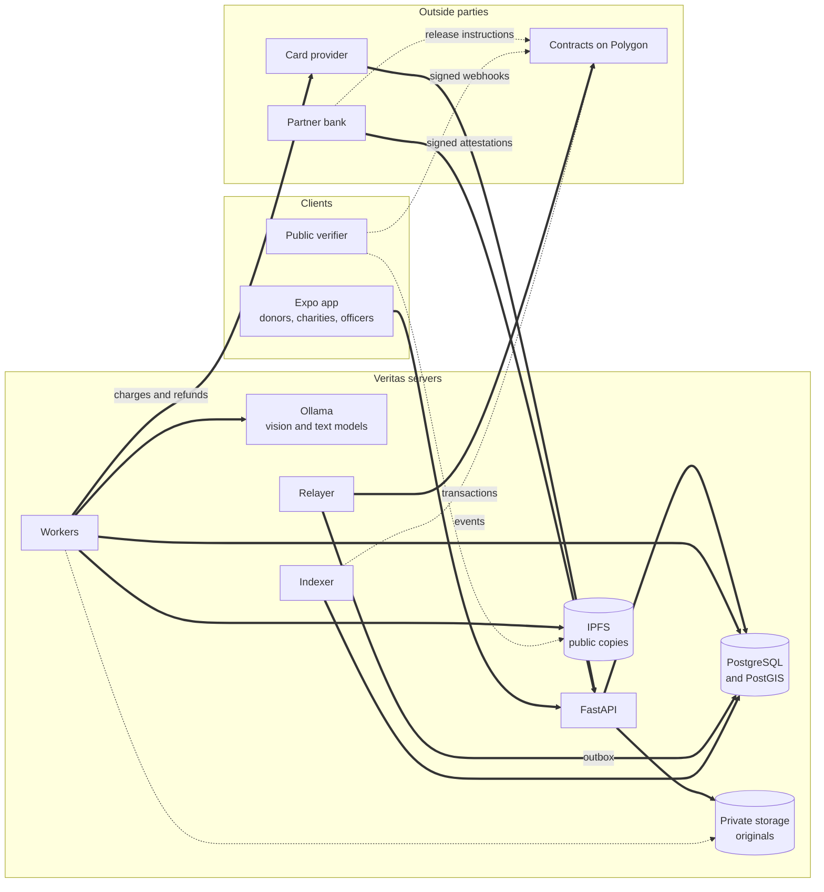

# Veritas architecture

This is how Veritas is put together: the parts of the system, the technology, exactly what goes on the blockchain and what does not, and how money and evidence travel from a donor to a contractor. When the design changes, this file changes with it.

## 1. Goals and constraints

- **Donors should not have to trust us.** Every promise, donation, decision and payout has to be checkable from public data, without asking Veritas.
- **No crypto in the donor's face.** Donors pay by card in manat. They never need a wallet, never pay gas and never see a token.
- **Money stays in a bank.** Crypto escrow has no clear legal basis in Azerbaijan yet. The manat sits in an escrow account at a licensed partner bank. The blockchain holds the rules and the record, and tells the bank when money may move.
- **Nothing personal on-chain.** The chain gets hashes, amounts and decisions. Names, phone numbers, card data, faces and bank accounts stay off it.
- **Evidence stays on our servers.** Photos and invoices are analysed with local models. Nothing is sent to an outside AI service.
- **AI advises, humans decide, the chain enforces.** No model output can release money.

## 2. System overview

Thick arrows call or write. Dotted arrows only read.

**Client app.** One Expo codebase for iOS, Android and web. Donors give, track, vote and choose refunds or redirects. Charity field staff capture evidence. Verification Officers, the independent reviewers named in each Passport (an audit firm or a partner organisation, for example), review and sign. The app only talks to our API and never calls the chain, but it holds the user's own signing key (section 5).

**API.** A FastAPI service for accounts, Passports, donations, evidence intake, votes, timelines and the impact map.

**PostgreSQL.** The main database. PostGIS holds project sites and geofences. The same database runs the job queue and the outbox for chain writes, and keeps a copy of every contract event.

**Workers.** Background jobs: the evidence pipeline, hourly donation batches, Pay-on-Proof charges, daily reconciliation and push notifications.

**Ollama.** Serves a vision model and a text model on our own hardware.

**Storage.** Original evidence goes to private S3-compatible storage. A redacted public copy goes to our IPFS node and is pinned by an independent provider as well, so it survives even if we don't.

**Relayer.** The only process that sends transactions, and the one that pays the gas. On its own it cannot release money, vote or confirm a payout (section 5).

**Indexer.** Reads contract events from finalised blocks into PostgreSQL, so timelines load fast. Every status still links to its transaction on the public explorer.

**Card provider.** Takes card payments, keeps saved cards for Pay-on-Proof and handles refunds.

**Partner bank.** Holds the escrow account, pays contractors, and signs deposits, payouts and the daily balance with its own key. Ideally it is also the card acquirer, so it sees every payment as it happens. In the demo this is a small MockBank service with its own key.

**Public verifier.** A static page that checks a receipt against the chain and IPFS through public endpoints. It never calls our API, so it still tells the truth if our servers are down or lying. Anyone can host a copy.

## 3. Tech stack

| Area | Choice | Why |
| - | - | - |
| App | Expo (React Native, TypeScript) | Camera, GPS, secure key storage and app attestation need a real native app. The same code builds the web version. |
| API | Python 3.12, FastAPI, Pydantic v2 | One language for the API, the evidence checks and the models. Pydantic models double as the JSON schema the AI has to follow. |
| Database | PostgreSQL 17 with PostGIS, SQLAlchemy 2, Alembic | One database for data, geofences, jobs and the chain outbox. |
| Jobs | Procrastinate | A task queue on top of PostgreSQL, with retries, locks and periodic jobs. No Redis to run. |
| Image checks | Pillow, OpenCV, imagehash, c2pa-python | Hashes, perceptual hashes, metadata and content credentials. |
| OCR | Tesseract 5 with Azerbaijani, Russian and English | Runs locally and reads Azerbaijani Latin script. |
| AI | Ollama with a vision model (Qwen2.5-VL 7B or Gemma 3 12B to start) and a text model | Local, cheap per check, JSON output that follows a schema. We pick the final models after testing on our own samples. |
| Storage | Private S3-compatible bucket, IPFS (Kubo) plus a second pinning provider | Private originals, public copies anyone can check. |
| Contracts | Solidity 0.8, OpenZeppelin Contracts 5, Foundry | Audited building blocks and fast tests with fuzzing. |
| Chain access | web3.py | The relayer and the indexer stay in Python. |
| Network | Polygon Amoy for the demo, Polygon PoS for production | Public EVM chain, fees well under a cent, mature explorers. Base would work the same way. |
| Maps | MapLibre with OpenStreetMap data | Impact map without a paid map API. |
| PDFs | WeasyPrint | Receipts for tax and CSR reporting. |
| Tooling | uv, Ruff, pytest, Docker Compose | Simple and fast. |

A few of these need a reason.

**PostgreSQL as the job queue.** Every chain write starts as a row in an outbox table, written in the same transaction as the change that caused it. If that transaction commits, the chain write will happen exactly once. If it rolls back, the write never existed. A separate Redis queue can't promise that without extra work. At our volume PostgreSQL carries the queue easily, and Celery with Redis is the fallback if that ever changes.

**Solidity, not Vyper.** Vyper reads like Python, but Solidity has OpenZeppelin's audited contracts and far more auditors. Contract tests are written in Solidity with Foundry, and end-to-end tests in Python with pytest and web3.py against a local Anvil chain.

**No ERC-4337.** Account abstraction is the usual way to hide gas from users. We don't need it, because donors never hold anything on-chain. Each user signs messages with a key on their phone, the relayer submits them and pays, and our contracts check the signature (EIP-712). Same experience, much less infrastructure. If stablecoin donations from abroad come later, smart wallets can come with them.

**vAZN instead of MockUSDC.** The escrows count money in vAZN, an accounting token where 1 vAZN is 1 manat in the bank's escrow account. Only a bank signature can mint or burn it, and it can only move between Veritas contracts, so it can't leave the system or be traded. It keeps the books in manat and makes the escrow balance visible on the explorer. The same escrow can hold a real stablecoin later (section 6).
