<h1 align="center">Veritas</h1>

<p align="center"><b>Donations that move only when the work is proven.</b><br>
AI advises, humans decide, the blockchain enforces.</p>

<p align="center">
  <a href="https://veritas.173.212.195.158.sslip.io"></a>
  <a href="https://drive.google.com/file/d/1ZFfALrV7v85nSqNO9sHl1N5nloUg5FhI/view?usp=sharing"></a>
</p>
<p align="center">
  <a href="https://github.com/eminroot/veritas/actions/workflows/backend.yml"></a>
  <a href="https://github.com/eminroot/veritas/actions/workflows/contracts.yml"></a>
</p>
<p align="center">
  
  
  
  
  
  
  
  
  
</p>

> [!TIP]
> **Our prototype is live: [veritas.173.212.195.158.sslip.io](https://veritas.173.212.195.158.sslip.io)**
>
> **Prefer to watch first?** Here is a [1-minute video of our prototype](https://drive.google.com/file/d/1ZFfALrV7v85nSqNO9sHl1N5nloUg5FhI/view?usp=sharing).
>
> Dear jury, you can test it right now, nothing to install. Open the [sign-in page](https://veritas.173.212.195.158.sslip.io/login) and either:
>
> - sign in with **`admin@gmail.com`** / **`admin1234`**, or
> - press **Demo donor** or **Demo organisation** to try each side of Veritas in one click.
>
> Worth a look: give to a project and see where your money waits, open a project's proof, publish a Passport as the organisation, and ask the assistant in the corner anything about how Veritas works. Projects and amounts are sample data, so feel free to click everything.

Veritas is a donation platform for Azerbaijan. A registered organisation publishes a **Project Passport** before it raises a single manat: the goal, a line-item budget for each milestone, the contractor who will do the work, the proof each milestone needs and who decides. Donations wait in **escrow**, milestone by milestone. The money for a milestone moves only after photos from the site pass automated checks, an independent **Verification Officer** signs an approval and the donors who paid for that milestone vote. It then goes straight to the contractor's verified bank account against an invoice. Every step is written to a public blockchain, so nobody can quietly change the record or move the money, Veritas included.

| | |
|---|---|
| **For judges** | Open the [live prototype](https://veritas.173.212.195.158.sslip.io) and sign in with `admin@gmail.com` / `admin1234` ([section 3](#3-try-it)), or watch the [1-minute video](https://drive.google.com/file/d/1ZFfALrV7v85nSqNO9sHl1N5nloUg5FhI/view?usp=sharing). |
| **Quick read** | [Purpose](#1-purpose), [the story](#2-a-short-story-fictional), [the journeys in screenshots](#5-the-journeys-screen-by-screen). |
| **Diagrams** | [Use cases](#6-use-case-diagram), [architecture](#7-architecture), [data flow](#8-data-flow-diagrams), [entity relationships](#103-the-main-entities), [star schema](#11-analytics-model-the-star-schema). |
| **Dictionaries** | [Process dictionary](#9-process-dictionary), [table and column dictionary](#105-table-dictionary), [star schema dictionary](#116-table-dictionary), [metafile](docs/analytics/metadata.yml). |
| **Numbers** | [Veritas in numbers](#4-veritas-in-numbers), [metrics and how each is calculated](#12-metrics). |

<details>
<summary><b>All sections</b></summary>

1. [Purpose](#1-purpose)
2. [A short story (fictional)](#2-a-short-story-fictional)
3. [Try it](#3-try-it)
4. [Veritas in numbers](#4-veritas-in-numbers)
5. [The journeys, screen by screen](#5-the-journeys-screen-by-screen)
6. [Use case diagram](#6-use-case-diagram)
7. [Architecture](#7-architecture)
8. [Data flow diagrams](#8-data-flow-diagrams)
9. [Process dictionary](#9-process-dictionary)
10. [Data model: the app database](#10-data-model-the-app-database)
11. [Analytics model: the star schema](#11-analytics-model-the-star-schema)
12. [Metrics](#12-metrics)
13. [Assumptions](#13-assumptions)
14. [Run it](#14-run-it)
15. [Stack](#15-stack)
16. [Repository layout](#16-repository-layout)
17. [Roadmap](#17-roadmap)
18. [How it scales](#18-how-it-scales)
19. [The same building blocks elsewhere](#19-the-same-building-blocks-elsewhere)
20. [Team](#20-team)

</details>

---

## 1. Purpose

**The problem.** A donor gives, and then loses sight of the money. Reports arrive months later, if at all, and they are written by the same organisation that spent it. Donors who were let down once stop giving, and honest organisations pay for the dishonest ones.

**The solution.** Hold every donation in escrow and release it in parts, each part only when the work it pays for is proven:

1. the promises are fixed before the first donation (the Passport, locked on-chain);
2. the proof is captured on site, with GPS, the time and a one-time code in the picture;
3. software checks the proof, a person signs the decision, and the donors of that milestone vote;
4. the money goes to the contractor named in the Passport, never to a personal account;
5. every step is public and permanent, but nothing personal is put on-chain.

**Who it is for.**

| Who | What they get |
|---|---|
| **Donor** | Gives by card in manat. Sees where every manat is: waiting, released or back with them. Votes on the milestones they paid for. Gets the money back or moves it if a project stops. |
| **Organisation** (charity, foundation, public union) | Proves it is trustworthy once, then raises money with proof built in instead of reports after the fact. |
| **Field worker** | Captures the evidence on site with a phone. |
| **Verification Officer** | An independent reviewer named in the Passport, who signs approvals or rejections. |
| **Veritas admin** | Verifies organisations, contractors and officers before they can take part. |
| **Partner bank** | Holds the money in a regulated account and pays contractors and refunds against signed instructions. |

**What it is not.** Not personal fundraising: only verified organisations raise money. Not crypto for donors: no wallet, no gas, nothing to install. The AI does not decide anything: it writes a report that a person reads. And it is a prototype: nothing is deployed to a public chain yet, and the projects, organisations and amounts in the web app are **sample data**, marked as such on every screen.

---

## 2. A short story (fictional)

Aysel is a teacher in Bakı. She wants to help families going back to Ağdam, but the last time she gave to a building project she never found out whether anything was built.

**With Veritas** she opens *Homes for 20 families returning to Ağdam* and:

1. **sees the plan before she gives.** Four milestones, each with its budget, deadline and the proof it needs. The contractor is named: Yeni Ev Tikinti. The first milestone, the foundations, is already paid: 48 photos from the site, 5 of 5 checks passed, recorded on-chain on 2 September and paid on 6 September;
2. **gives ₼50 by card.** The app tells her exactly where the money will wait: milestone 3, windows, doors and wiring. Nobody can spend it yet, the organisation included;
3. **gets proof, not a report.** A field worker photographs the new windows. Every photo carries the GPS position and the time, and a one-time code is shown in the pictures. Veritas checks that the photos were taken inside the site's boundary, within the milestone's dates, and were never used before;
4. **has a say.** The Verification Officer reviews the evidence and signs an approval. Aysel gets a notification and votes yes on her phone, together with the other donors of that milestone;
5. **sees it paid.** The vote passes, the escrow releases the money and the bank pays the contractor's verified account against the invoice. On her dashboard the ₼50 moves from *in escrow* to *released*, with a link to the public transaction.

If the project had stopped, Aysel would have chosen: her money back to her card, or moved to another verified project. If she had not chosen in time, the Passport's default would have applied.

---

## 3. Try it

**Live:** [https://veritas.173.212.195.158.sslip.io](https://veritas.173.212.195.158.sslip.io)

The web app has a demo account for the judges and anyone else trying Veritas:

| Email | Password |
|---|---|
| `admin@gmail.com` | `admin1234` |

No password at all? The [sign-in page](https://veritas.173.212.195.158.sslip.io/login) also has **Demo donor** and **Demo organisation** buttons: the first gives and follows the money, the second is a verified organisation that plans and publishes projects.

Every account, this one included, starts with the same **sample portfolio** until it makes donations of its own: 11 gifts across 11 projects, with money released to contractors, money waiting in escrow and a refund from a stopped project. Anything built on sample data carries a dashed *Sample data* label. You can also sign up with any email and a password, or with Google.

To make the demo account on a new database: `cd backend && uv run python scripts/seed_demo.py` (running it again resets its password; the Docker setup does this on every start). How to run everything locally is in [section 14](#14-run-it), and how the live server is set up is in [DEPLOY.md](DEPLOY.md).

---

## 4. Veritas in numbers

The first three tables come from the web app's **sample data** (invented, for the demo). The last one is the code itself, measured on the repository.

<table>
<tr>
<td valign="top">

| The sample world | |
|---|---|
| Projects | **25** |
| live / completed / stopped | 22 / 2 / 1 |
| Organisations | 14 |
| Causes | 14 |
| Regions | 14 + abroad |
| About the war in Ukraine | 3 (2 in Ukraine) |
| Milestones | 70 |

</td>
<td valign="top">

| The money | |
|---|---|
| Goal, all projects | ₼1,857,700 |
| Raised | **₼1,362,360** (73.3%) |
| Released to contractors | ₼490,000 |
| Waiting in escrow | ₼853,360 |
| Back with donors | ₼19,000 |
| Donors | 27,385 |
| Last 30 days | 6,278 gifts, ₼323,090 |

</td>
</tr>
<tr>
<td valign="top">

| The proof | |
|---|---|
| Evidence bundles | 33 |
| Photos from sites | 901 |
| Checks passed | **157 of 165** (95.2%) |
| Bundles passing all 5 checks | 28 of 33 (84.8%) |
| Evidence to payment | median **4 days** (2 to 6) |

</td>
<td valign="top">

| The build | |
|---|---|
| Backend tests | **655** pass (1 skipped) |
| Contract tests | **74** pass |
| API endpoints | 96 |
| Database tables | 41 (+8 mock) |
| Smart contracts | 9 |
| Web app pages | 20 |

</td>
</tr>
</table>

How every number is calculated is in [section 12](#12-metrics).

---

## 5. The journeys, screen by screen

Each journey reads from top to bottom, in the order a person goes through it. The screenshots are the real web app in a laptop browser (1120 × 800), signed in as the demo account where a step needs an account. They are shown at full width, so nothing needs zooming; click one to open it at full resolution.

### 5.1 The donor

**1 Land ➜ 2 Pick a cause ➜ 3 Open a project ➜ 4 Read the plan ➜ 5 Give ➜ 6 Sign up ➜ 7 See where the money is ➜ 8 Follow each project ➜ 9 Track each gift ➜ 10 See the country**

**1 · Land.** The landing page: "Every manat, proven." One button to give, and a one-minute tour of how the money moves.

<p align="center">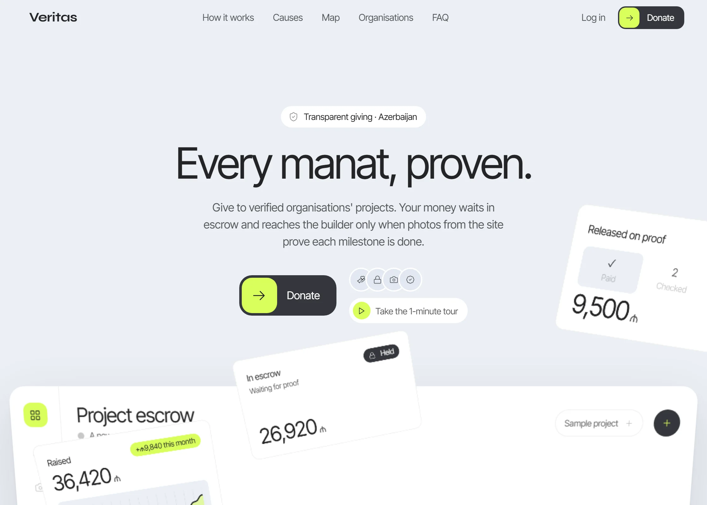</p>

<p align="center"></p>

**2 · Pick a cause.** Fourteen causes, each with its number of projects.

<p align="center">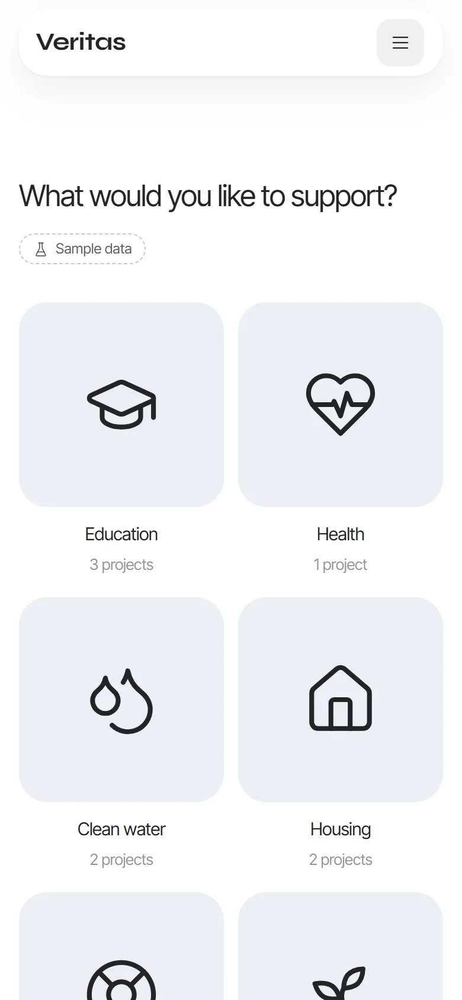</p>

<p align="center"></p>

**3 · Open a project.** *Homes for 20 families returning to Ağdam*: ₼208,300 raised of ₼260,000, how much is released and how much waits in escrow, the number of donors, and the milestone it is on now.

<p align="center">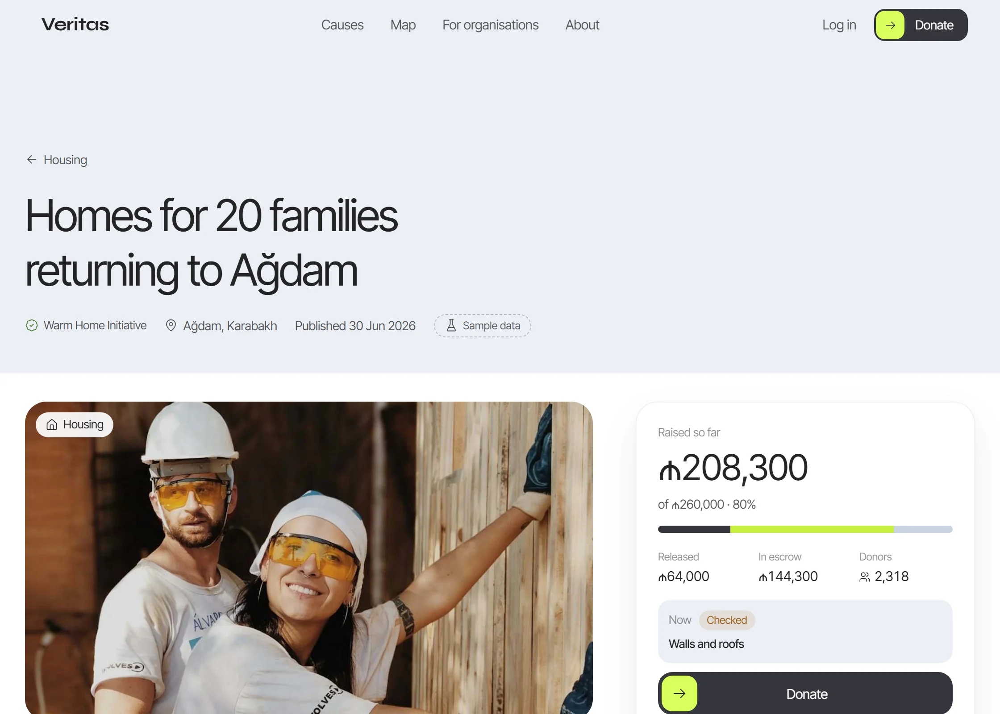</p>

<p align="center"></p>

**4 · Read the plan.** Every milestone with its money, its photos from the site, the checks it passed, the day it was recorded on-chain and the day it was paid.

<p align="center">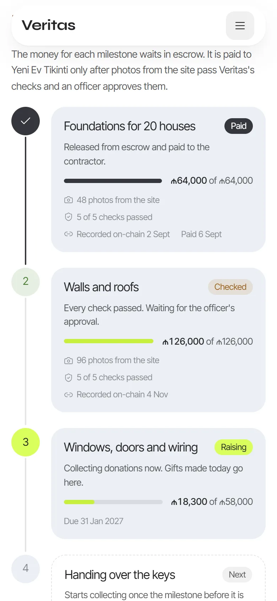</p>

<p align="center"></p>

**5 · Give.** Give once, or pay on proof. The dialog says which milestone the ₼50 would wait in.

<p align="center">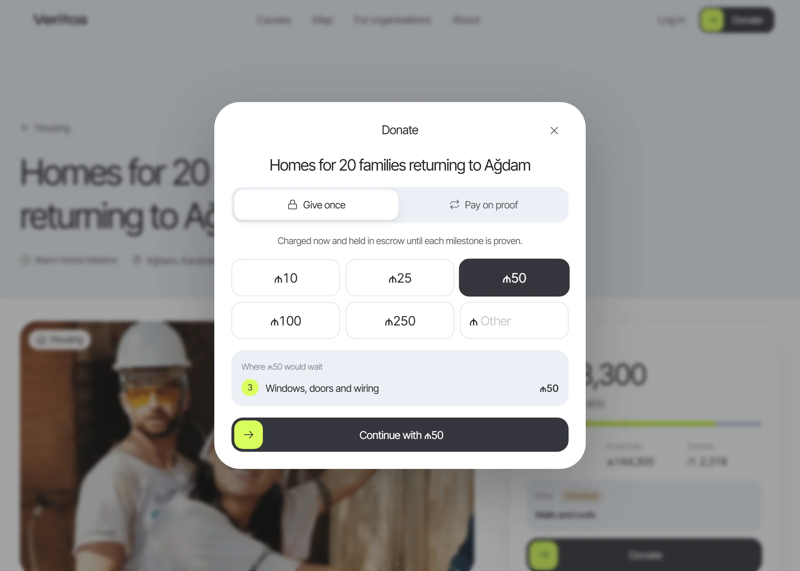</p>

<p align="center"></p>

**6 · Sign up.** As a donor or as an organisation, with Google or with an email and a password.

<p align="center">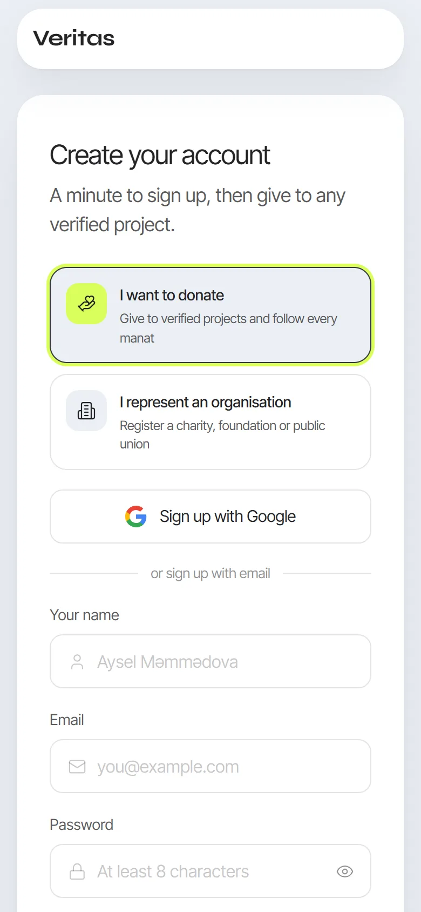</p>

<p align="center"></p>

**7 · See where the money is.** The donor's dashboard: ₼510 given across 11 projects; ₼245.50 waiting for proof, ₼235.80 paid to the builders on proof, ₼28.70 refunded from stopped projects.

<p align="center">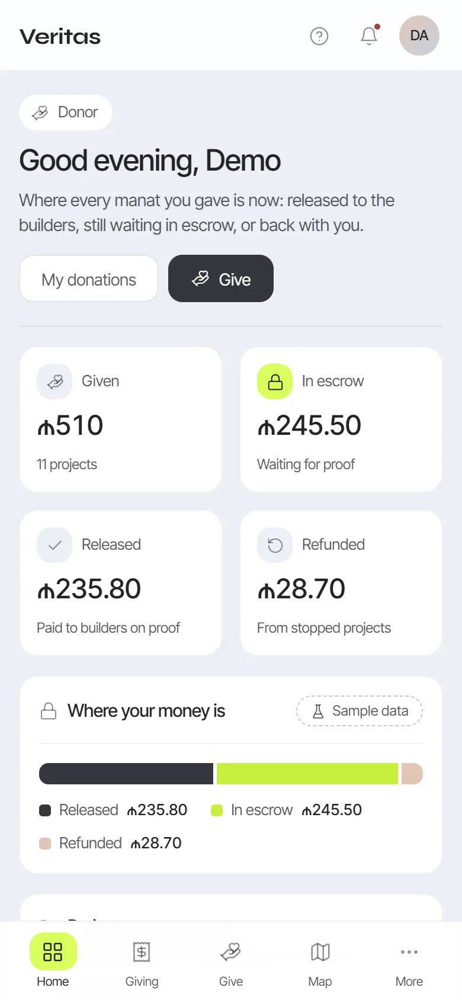</p>

<p align="center"></p>

**8 · Follow each project.** For each project: released (dark), in escrow (green) and still needed (grey), beside the latest news from the sites.

<p align="center">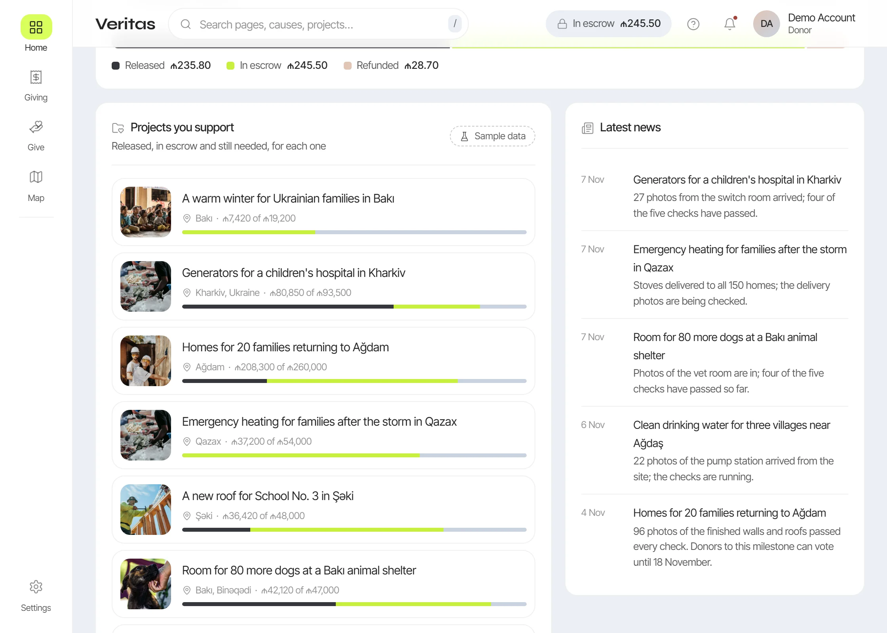</p>

<p align="center"></p>

**9 · Track each gift.** Every gift with its date, card and transaction, split into given, released and in escrow, with its status.

<p align="center">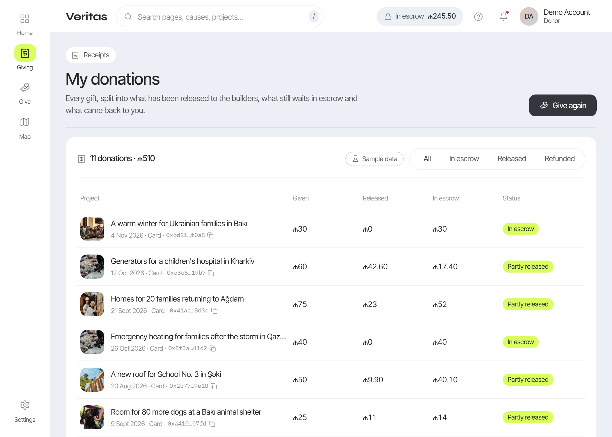</p>

<p align="center"></p>

**10 · See the country.** Giving by region on the map of Azerbaijan's economic regions: 6,278 gifts and ₼323,090 in the last 30 days.

<p align="center">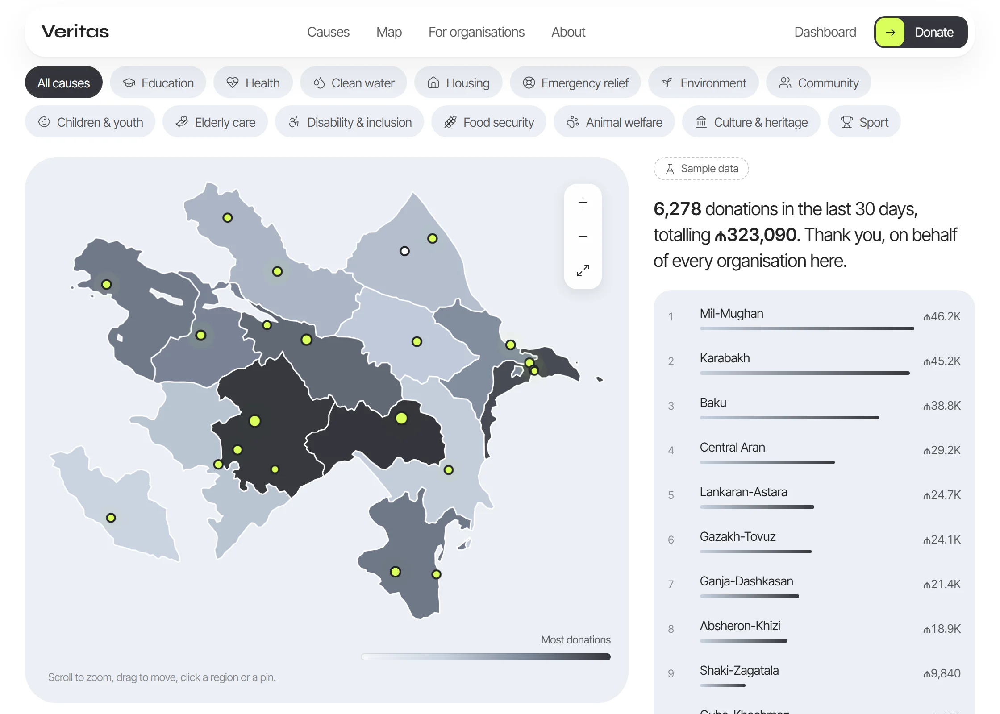</p>

### 5.2 The organisation

**1 Sign up ➜ 2 Apply ➜ 3 Get verified ➜ 4 Plan projects ➜ 5 Publish and get paid**

**1 · Sign up.** "I represent an organisation": the person's own account first, the organisation's details next.

<p align="center">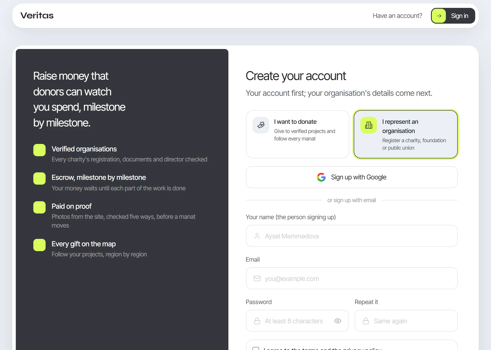</p>

<p align="center"></p>

**2 · Apply.** Four steps: the organisation (registered name, VÖEN, legal form, address), its people, its documents, then sending it for review.

<p align="center">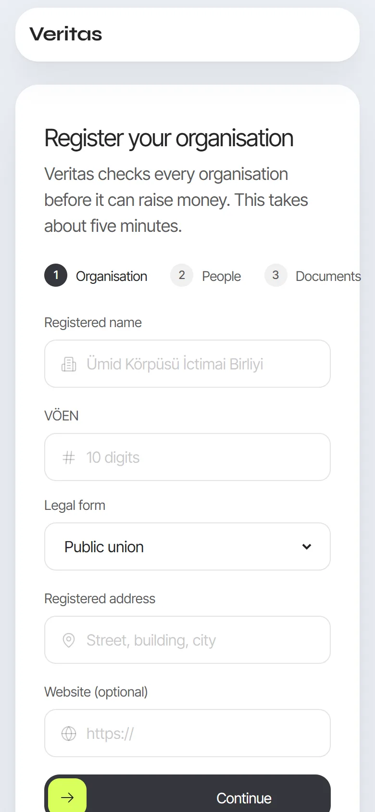</p>

<p align="center"></p>

**3 · Get verified.** A Veritas admin checks the details and the documents, which only Veritas's reviewers can see. The status here: under review.

<p align="center">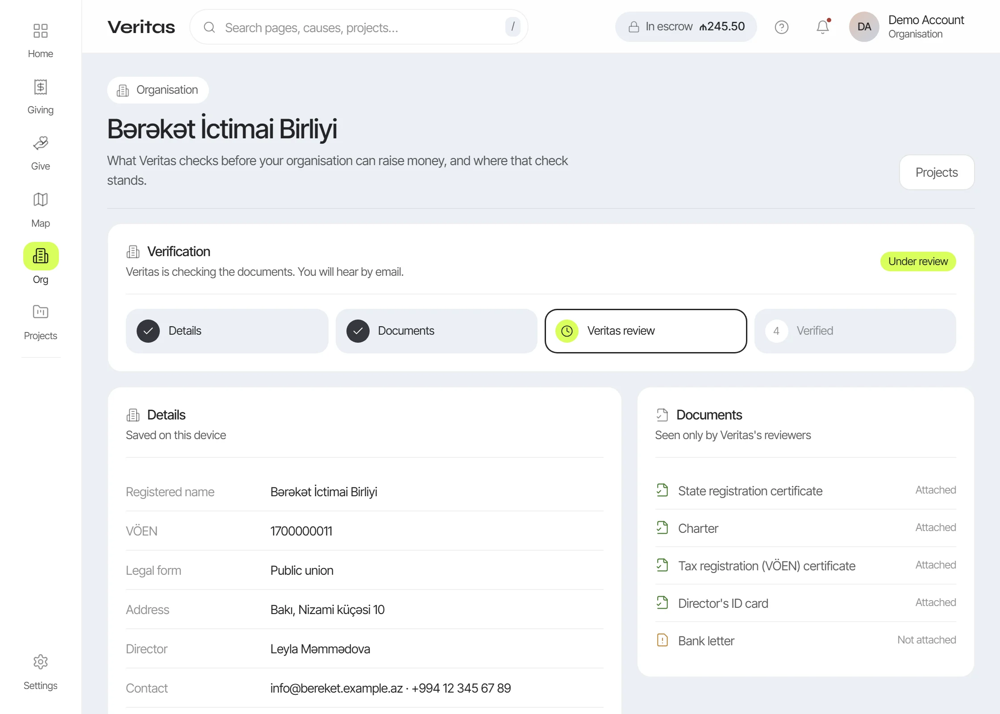</p>

<p align="center"></p>

**4 · Plan projects.** Projects can be published once the organisation is verified; the page lists what each project needs.

<p align="center">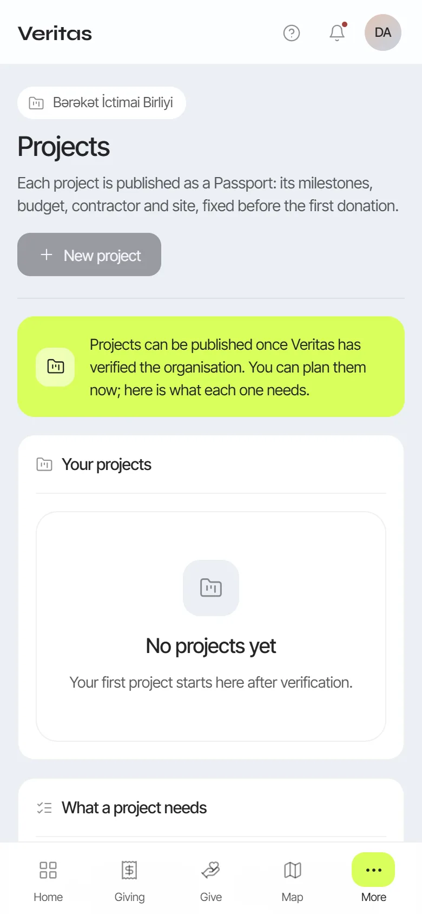</p>

<p align="center"></p>

**5 · Then.** Publishing the Passport, capturing evidence on site, signing it and getting paid on approval run through the API today, as section 5.3 shows; their screens come next.

### 5.3 Behind the screens: one gift, start to finish

What happens to Aysel's ₼50 after she presses *Continue*. Each box is a step, numbered in the order it happens. (Every diagram in this README is an image drawn from a Mermaid file in [docs/diagrams](docs/diagrams); click a diagram to open its source, which GitHub draws live, with zoom.)

<p align="center"><a href="docs/diagrams/gift-flow.md">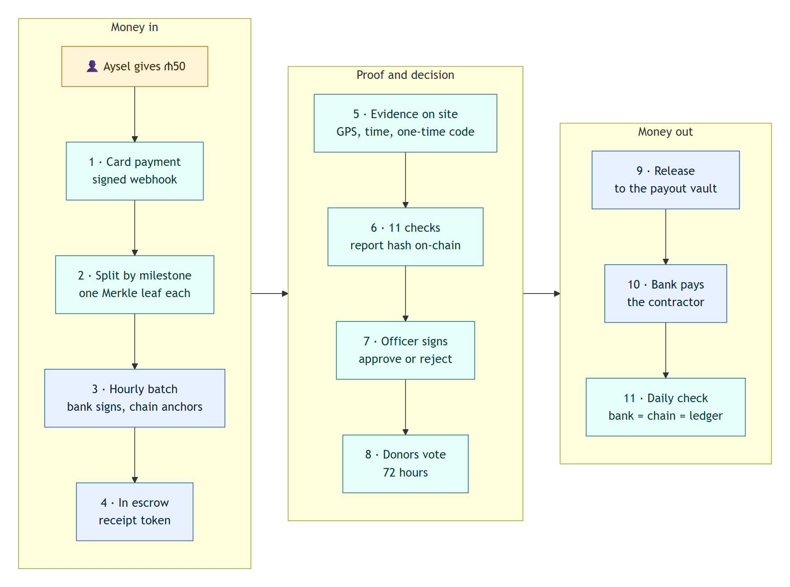</a></p>

| # | Who acts | What happens | Written to (tables) | On-chain |
|---|---|---|---|---|
| 1 | Donor, card provider | The card provider confirms the payment with a signed webhook. Veritas checks the signature and asks the provider again before counting any money. | `donations` | no |
| 2 | Veritas | The amount is split across the milestones by the Passport's rule. Each part gets a random salt and becomes a leaf of a Merkle tree. | `allocations` | no |
| 3 | Veritas, partner bank | Every hour, all new leaves go into one tree. The bank signs its root and totals; one transaction anchors them. | `batches`, `batch_leaves`, `chain_outbox` | root and totals |
| 4 | Contracts | The money is now in the project's escrow, per milestone. A first-time donor gets a receipt token for their project key. | `receipts` | receipt |
| 5 | Field worker | A capture session gives a one-time code to show in a photo. Photos, video and invoices are hashed on the phone, uploaded, then sealed by a signed manifest. | `capture_sessions`, `evidence_items`, `photo_hashes`, `evidence_bundles` | bundle hash |
| 6 | Veritas | 11 checks run (place, time, reused photos, completeness and more). The organisation signs the bundle; a redacted copy goes to IPFS. | `evidence_checks`, `check_reports` | report hash, pass or fail |
| 7 | Verification Officer | Signs approve or reject. Overriding a failed hard check needs a written reason, whose hash goes on-chain. | `officer_decisions` | decision |
| 8 | Donors of that milestone | Vote with their own key for 72 hours. More than half of the votes cast must say yes; with less than 10% turnout the vote is extended once, then the officer's decision stands. | `ballots`, `votes` | each vote, the result |
| 9 | Contracts | The escrow releases the milestone to the payout vault, naming the contractor and the invoice. | `releases` | release |
| 10 | Partner bank | Pays the contractor's verified account and confirms on-chain. A failed payment goes back to escrow and alerts a person. | `payouts` | confirmation |
| 11 | Veritas, bank | Once a day the bank's balance, the money on-chain and Veritas's ledger must agree. If they do not, releases stop by themselves. | `reconciliations`, `alerts` | bank's signed balance |

---

## 6. Use case diagram

> **A high-level view.** The diagrams from here to section 11 show the system at a high level, on purpose. Each box stands for a whole piece of work and is drawn as a black box: what happens inside it is not shown. The code, [ARCHITECTURE.md](ARCHITECTURE.md) and the dictionaries further down hold the detail.

Who can do what: people in amber, the outside systems in purple, Veritas as the big box.

**6.1 Donors**

<p align="center"><a href="docs/diagrams/use-cases-donors.md">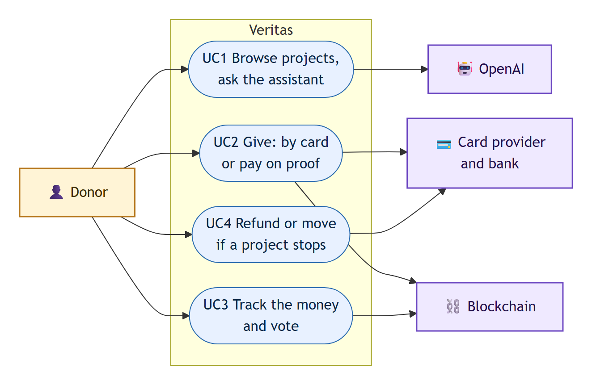</a></p>

**6.2 Organisations, and the people who check them**

<p align="center"><a href="docs/diagrams/use-cases-organisations.md">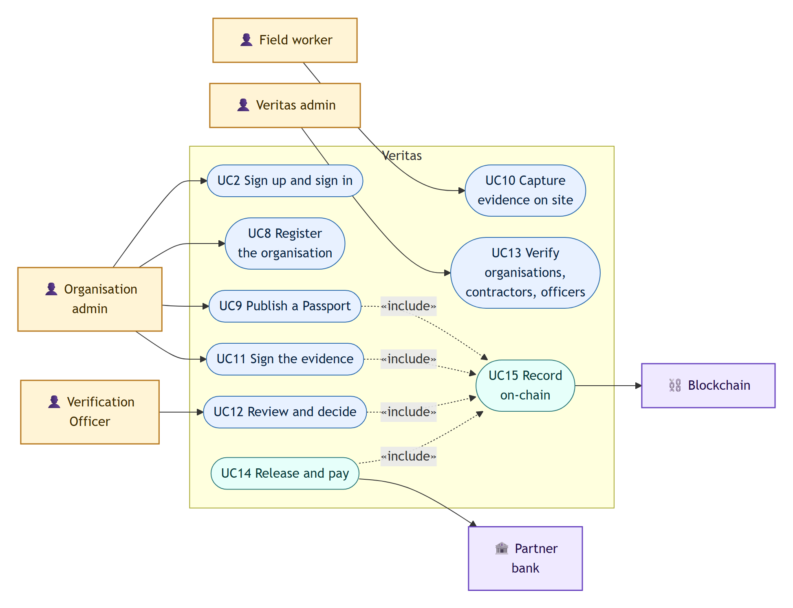</a></p>

**Reading the symbols**

| Symbol | Meaning |
|---|---|
| 👤 amber box | An **actor**: a person in a role. One person can have several roles. |
| purple box | An **outside system** Veritas works with but does not control. |
| blue rounded box | A **use case**: one thing an actor gets done. How it works inside is not shown. |
| green rounded box | A use case Veritas runs by itself once its rules are met. |
| big box *Veritas* | The **system boundary**: everything inside is Veritas. |
| line | This actor or system takes part in the use case. |
| dotted arrow | One use case leads to the next. |

**The use cases**

| ID | Use case | Who | Where it lives today |
|---|---|---|---|
| UC1 | Browse projects, organisations and the map; ask the assistant | Anyone | Web app (on sample data); the assistant through the API and OpenAI |
| UC2 | Give by card, or pledge to pay on proof | Donor | API and contracts; the web app's card form is next |
| UC3 | Track every gift; vote on milestones | Donor | Web app on sample data; API and contracts |
| UC4 | Get a refund or move the money after a stop | Donor | API and contracts |
| UC5 | Register the organisation and get verified | Organisation, Veritas admin | Web app and API |
| UC6 | Publish a Project Passport | Organisation | API and contracts |
| UC7 | Prove the work on site: capture and sign the evidence | Organisation | API (the capture screen is next) |
| UC8 | Review the evidence and decide | Verification Officer | API and contracts |
| UC9 | Release the money and pay the contractor | Veritas, partner bank | API, contracts, the bank adapter |

---

## 7. Architecture

A high-level view: each box is a black box.

<p align="center"><a href="docs/diagrams/architecture.md">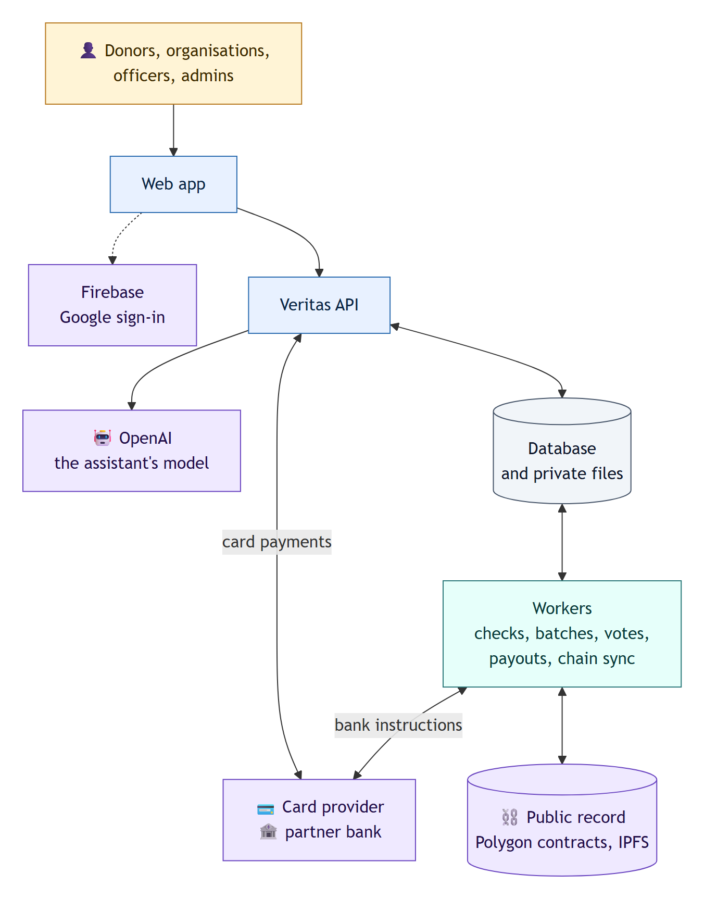</a></p>

Colours: amber are people, blue the Veritas apps, green Veritas's background work, grey its storage, purple the services outside Veritas.

| Part | What it does |
|---|---|
| Web app | The pages people use (`frontend/`). It talks only to the API. |
| Veritas API | Accounts, organisations, Passports, donations, evidence, decisions and the assistant (`backend/src/veritas/api`): 96 endpoints. |
| Database and private files | Everything Veritas knows, in 41 tables (section 10), and the originals of documents and evidence. |
| Workers | The background work: the 11 evidence checks, hourly batches, closing votes, payouts, the daily check, and sending to and reading from the blockchain. |
| Card provider and partner bank | Take card payments, hold the money, pay contractors and refunds. Pretend versions run in development and the demo (`backend/src/veritas/mocks`). |
| Public record | The smart contracts on Polygon hold the escrow and record every step; IPFS keeps the public copies (`contracts/`). |
| OpenAI | Writes the assistant's answers from a fixed description of Veritas. The key stays on the server. |
| Firebase | Only the "Continue with Google" button. |

**What goes on-chain, and what never does.** On-chain: hashes of Passports, evidence and check reports; batch roots and totals; receipts held by per-project donor keys; decisions, votes and releases; the bank's confirmations and daily balance. Never on-chain: names, phone numbers, emails, card numbers, photos or documents. A donor's key is different for every project, so their gifts cannot be linked to each other on-chain. The full design is in [ARCHITECTURE.md](ARCHITECTURE.md).

---

## 8. Data flow diagrams

What information moves where, at a high level. Level 0 shows Veritas as one box. Level 1 opens it into five processes, and each process is still a black box. The numbers match the [process dictionary](#9-process-dictionary).

### 8.1 Reading the symbols

| Symbol | Name | Meaning |
|---|---|---|
| Amber rectangle | External entity | A person or a system outside Veritas that sends or receives data. |
| Green rounded box with a number | Process | Something Veritas does that turns incoming data into outgoing data. 1.0 is process 1. |
| Grey cylinder with D and a number | Data store | Data at rest: a group of database tables. |
| Arrow with a label | Data flow | Data moving in the direction of the arrow; the label says what. |
| Double arrow | Two flows | Data goes both ways, for example read and write. |

### 8.2 Level 0: the context

<p align="center"><a href="docs/diagrams/dfd-level-0.md">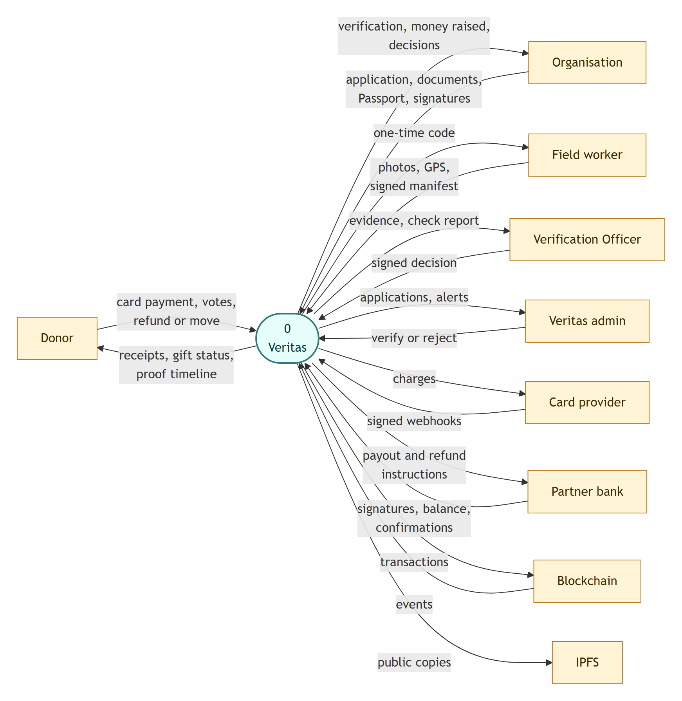</a></p>

### 8.3 Level 1: inside Veritas

Every process also records its steps on the blockchain; Level 0 shows that flow, so it is left out here.

<p align="center"><a href="docs/diagrams/dfd-level-1.md">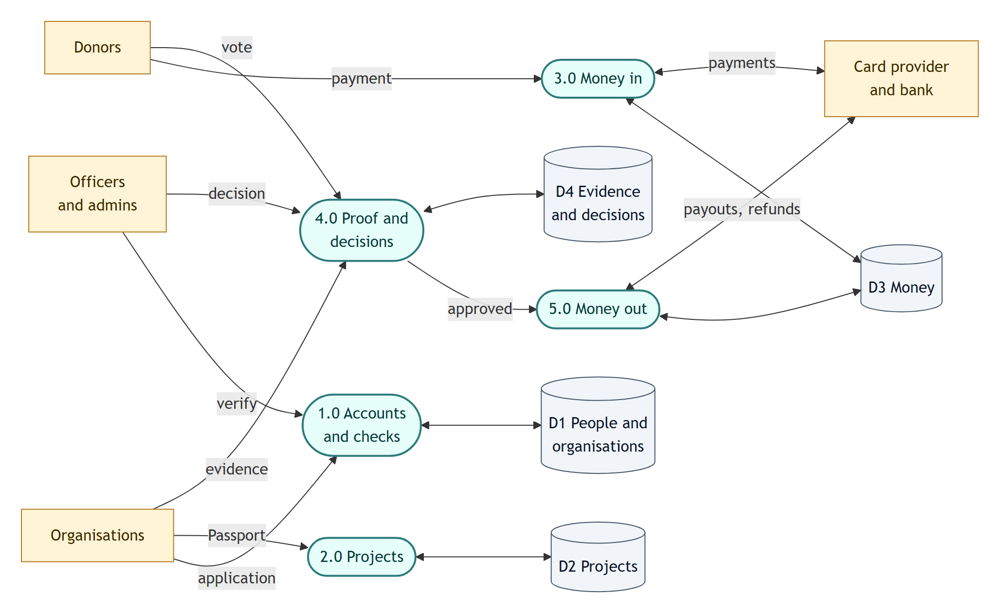</a></p>

### 8.4 The data stores

| Store | What it holds | Tables |
|---|---|---|
| D1 People and organisations | Accounts, sign-in, organisations, contractors, officers, their documents | `users`, `sessions`, `password_resets`, `login_codes`, `devices`, `device_challenges`, `charities`, `charity_members`, `contractors`, `officers`, `kyb_documents` |
| D2 Projects | The promises | `projects`, `passports`, `milestones`, `budget_lines`, `sites` |
| D3 Money | Money in and out, and the daily check | `donations`, `allocations`, `batches`, `batch_leaves`, `receipts`, `pledges`, `pledge_charges`, `releases`, `payouts`, `claims`, `reconciliations` |
| D4 Evidence and decisions | Proof, checks, decisions and votes | `capture_sessions`, `evidence_items`, `photo_hashes`, `evidence_bundles`, `evidence_checks`, `check_reports`, `officer_decisions`, `ballots`, `votes` |

Behind every arrow to the blockchain sit the tables that send and read it: `chain_outbox`, `chain_events`, `chain_contracts`, `chain_cursor` and `alerts`. Private files (documents, evidence originals) are kept outside the database.

---

## 9. Process dictionary

The five processes of Level 1. Each is a black box here; the last column says where its code is, under `backend/src/veritas/`.

| No. | Process | What it does | Takes in | Gives out | Stores | Code |
|---|---|---|---|---|---|---|
| 1.0 | Accounts and checks | Signs people in (an email and a password, Google, or a phone code) and verifies organisations, contractors and officers. | Sign-in details, applications, documents | Sessions, verified organisations | D1 | `services/` |
| 2.0 | Projects | Checks and publishes a Project Passport, and locks its fingerprint on-chain. | The organisation's draft and signature | A published Passport: milestones, budgets, sites | D1, D2 | `services/passports.py` |
| 3.0 | Money in | Takes card payments and pledges, splits them by milestone, and anchors them every hour with the bank's signature. | Payments, pledges | Donations, receipts | D2, D3 | `payments/` |
| 4.0 | Proof and decisions | Collects the evidence from the site, runs the 11 checks, and takes the officer's decision and the donors' vote. | Photos, invoices, decisions, votes | Check reports, results | D2, D4 | `evidence/`, `decisions/` |
| 5.0 | Money out | Releases approved milestones to the contractor, refunds or moves money after a stop, and checks every day that the bank, the chain and the ledger agree. | Approvals, claims, the bank's answers | Payouts, refunds, the daily check | D3, D4 | `decisions/`, `payments/reconcile.py` |

Sending to the blockchain and reading it back (`chain/relayer.py`, `chain/indexer.py`) serves all five. The assistant (`assistant/`) only answers questions: it reads none of these stores.

---

## 10. Data model: the app database

### 10.1 Why it is shaped this way

The app database is where Veritas **writes**. It is normalised (third normal form): every fact is stored once, in the table it belongs to, and the database itself refuses data that breaks a rule, through 73 foreign keys, 59 unique constraints and 155 CHECK constraints. Reporting reads a different, simpler shape: the star schema in [section 11](#11-analytics-model-the-star-schema).

| Rule | Why |
|---|---|
| Money is a whole number of qəpik (`bigint`, columns end in `_qapik`) | Floats lose cents; ₼12.30 is `1230`. |
| Time is `timestamptz` in UTC (columns end in `_at`) | One clock for the API, the chain and the bank; pages show Baku time. |
| Statuses are `text` with a CHECK of the allowed values, not PostgreSQL enum types | Adding a status is an ordinary migration; adding a value to an enum type is not. |
| Hashes and signatures are `bytea` with an exact length CHECK | A 31-byte hash is a bug, caught by the database. |
| Ids are UUIDs, except where order or the chain decides the id (outbox order, batch numbers, ballot ids, contract addresses) | Ids can be made anywhere without asking the database, and reveal nothing about counts. |
| Constraint names follow one pattern: `pk_<table>`, `fk_<table>_<column>_<referred table>`, `uq_<table>_<columns>`, `ck_<table>_<rule>`, `ix_<table>_<columns>` | A migration can refer to a constraint by name, and the name is the same on every database. |
| Table names are plural snake case (`evidence_bundles`); columns are singular | One habit everywhere. |

### 10.2 Reading the diagram

The diagram uses **crow's foot** notation. Each end of a line says how many rows can be on that side.

| Symbol at a line's end | Meaning |
|---|---|
| `\|\|` | exactly one |
| `o\|` | zero or one |
| `o{` | zero or many |
| `\|{` | one or many |
| solid line `--` | a foreign key the database enforces |
| dotted line `..` | a link by value that the code keeps, with no foreign key (a milestone found by `project_id` and `milestone_index`) |

### 10.3 The main entities

A high-level view: 11 of the 41 tables, the ones the story needs, without their columns. The other 30 (sign-in, the money's batches and receipts, check results, the chain outbox and so on) are working details behind these; every table and column is in the dictionaries below.

<p align="center"><a href="docs/diagrams/erd-overview.md">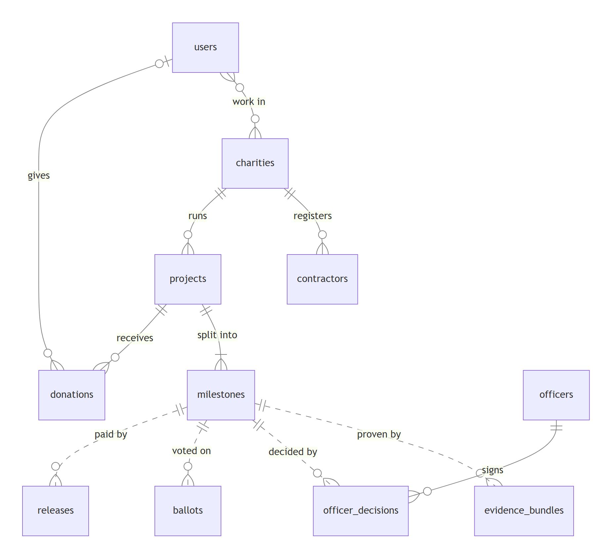</a></p>

### 10.4 Relationships in words

| From (the "one" side) | To (the "many" side) | Type | Meaning |
|---|---|---|---|
| `users` | `charities` | many : many | A person can work for several organisations, and an organisation has several people. The bridge table `charity_members` holds each pair, with a role. |
| `charities` | `contractors` | 1 : many | An organisation registers the companies it will pay. |
| `charities` | `projects` | 1 : many | An organisation runs projects. |
| `projects` | `milestones` | 1 : 1..many | A project is paid in milestones. |
| `projects` | `donations` | 1 : many | A project receives donations. |
| `users` | `donations` | 0..1 : many | A guest can give without an account. |
| `milestones` | `evidence_bundles` | 1 : many, logical | Each try at proving a milestone is one sealed bundle. |
| `officers` | `officer_decisions` | 1 : many | An officer signs many decisions. |
| `milestones` | `officer_decisions`, `ballots`, `releases` | 1 : many, logical | A milestone is decided, voted on and paid, one try at a time. |

**Many-to-many.** A database cannot store a many-to-many link directly, so a bridge table sits in the middle: each row of `charity_members` is one person in one organisation.

### 10.5 Table dictionary

<details>
<summary><b>All 41 tables</b>, what one row is and its primary key</summary>

| Table | Area | One row is... | Primary key |
|---|---|---|---|
| `users` | Accounts | one person's account | `id` |
| `sessions` | Accounts | one signed-in browser or phone | `id` |
| `password_resets` | Accounts | one emailed link to set a new password | `id` |
| `login_codes` | Accounts | one 6-digit code sent to a phone | `id` |
| `devices` | Accounts | one key held in a phone's secure storage | `id` |
| `device_challenges` | Accounts | one message to sign, to prove a key | `id` |
| `charities` | Organisations | one organisation | `id` |
| `charity_members` | Organisations | one person in one organisation | `id` |
| `contractors` | Organisations | one contractor | `id` |
| `officers` | Organisations | one Verification Officer | `id` |
| `kyb_documents` | Organisations | one uploaded document | `id` |
| `projects` | Projects | one project | `id` |
| `passports` | Projects | one version of a project's Passport | `id` |
| `milestones` | Projects | one stage of a project | `id` |
| `budget_lines` | Projects | one line of a milestone's budget | `id` |
| `sites` | Projects | one place where a milestone's work happens | `id` |
| `donations` | Money | one card payment or one pledge charge | `id` |
| `allocations` | Money | one part of a donation, for one milestone | `id` |
| `batches` | Money | one hourly Merkle tree | `id` (batch number) |
| `batch_leaves` | Money | one allocation's place in its batch | `allocation_id` |
| `receipts` | Money | one receipt token | `id` |
| `pledges` | Money | one pay-on-proof promise | `id` |
| `pledge_charges` | Money | one charge of a pledge | `id` |
| `releases` | Money | one release from escrow | `id` |
| `payouts` | Money | one instruction to the bank | `id` |
| `claims` | Money | one donor's choice after a stop | `id` |
| `reconciliations` | Money | one day's check | `id` |
| `capture_sessions` | Evidence | one visit to photograph a milestone | `id` |
| `evidence_items` | Evidence | one photo, video or document | `id` |
| `photo_hashes` | Evidence | one photo's fingerprint | `id` |
| `evidence_bundles` | Evidence | one milestone's evidence, sealed | `id` |
| `evidence_checks` | Evidence | one check of one bundle | `id` |
| `check_reports` | Evidence | one bundle's report | `id` |
| `officer_decisions` | Decisions | one signed decision | `id` |
| `ballots` | Decisions | one question put to donors | `id` (ballot id on-chain) |
| `votes` | Decisions | one donor's vote | `id` |
| `chain_outbox` | Chain | one blockchain call waiting to be sent | `id` (in order) |
| `chain_events` | Chain | one event the contracts emitted | `id` |
| `chain_contracts` | Chain | one deployed contract | `address` |
| `chain_cursor` | Chain | one reader's place in the chain | `name` |
| `alerts` | Chain | one thing an operator should look at | `id` |

</details>

Eight more tables start with `mock_`: the pretend card provider and bank used in development and the demo. They are not part of Veritas and are left out here.

### 10.6 Column dictionary

Every column of every table, generated from the models in `backend/src/veritas/db/models`, so types, keys and required flags are exact. Open an area to read it.

<details>
<summary><b>Accounts and organisations</b> (11 tables)</summary>


**`users`**: Everyone who signs in: donors, organisation staff, field workers, officers and Veritas staff. One row is one person's account.

| Column | Type | Rules | Meaning |
|---|---|---|---|
| `id` | uuid | PK | Primary key. |
| `phone` | text | unique, optional | For phone login in the app; +994 and 9 digits. Empty for accounts made on the web. |
| `email` | text | unique, optional | Lower case. Password logins use it; links to set a new password go to it. |
| `password_hash` | text | optional | scrypt with its salt and settings; empty means no password login. |
| `password_failures` | integer | required | Wrong passwords since the last right one. |
| `password_locked_until` | timestamptz | optional | Password logins are refused until then (after 10 wrong ones in a row). |
| `firebase_uid` | text | unique, optional | The Google account (through Firebase) that signs in here. |
| `display_name` | text | optional | The name shown in the web app. |
| `is_admin` | boolean | required | Veritas staff: verifies organisations, contractors and officers. |
| `recovery_failures` | integer | required | Wrong answers when recovering a receipt after a lost phone. |
| `created_at` | timestamptz | required | When the row was written (UTC). |
| `updated_at` | timestamptz | required | When the row last changed (UTC). |

**`sessions`**: A sign-in. Only the SHA-256 of its token is kept, so a copy of the database cannot sign anyone in. One row is one signed-in browser or phone.

| Column | Type | Rules | Meaning |
|---|---|---|---|
| `id` | uuid | PK | Primary key. |
| `user_id` | uuid | FK → `users`, required | The account. |
| `token_hash` | bytea | unique, required | SHA-256 of the token; the token itself is never stored. |
| `expires_at` | timestamptz | required | When it stops working. |
| `revoked_at` | timestamptz | optional | When it was ended (sign-out, new password). |
| `device_id` | uuid | FK → `devices`, optional | The phone key registered from this session. |
| `created_at` | timestamptz | required | When the row was written (UTC). |

**`password_resets`**: Kept only as a hash; works once and expires after 30 minutes. One row is one emailed link to set a new password.

| Column | Type | Rules | Meaning |
|---|---|---|---|
| `id` | uuid | PK | Primary key. |
| `user_id` | uuid | FK → `users`, required | The account. |
| `token_hash` | bytea | unique, required | SHA-256 of the token; the token itself is never stored. |
| `expires_at` | timestamptz | required | When it stops working. |
| `used_at` | timestamptz | optional | When the link was used; a link works once. |
| `created_at` | timestamptz | required | When the row was written (UTC). |

**`login_codes`**: Phone login in the app. Only an HMAC of the code is kept. One row is one 6-digit code sent to a phone.

| Column | Type | Rules | Meaning |
|---|---|---|---|
| `id` | uuid | PK | Primary key. |
| `phone` | text | required | Where the code was sent. |
| `code_hmac` | bytea | required | HMAC of the code, keyed with the server secret. |
| `expires_at` | timestamptz | required | When it stops working. |
| `attempts` | integer | required | Wrong guesses so far; too many kill the code. |
| `consumed_at` | timestamptz | optional | When it was used. |
| `created_at` | timestamptz | required | When the row was written (UTC). |

**`devices`**: Field workers sign evidence with it; a revoked key stays, so it can never come back. One row is one key held in a phone's secure storage.

| Column | Type | Rules | Meaning |
|---|---|---|---|
| `id` | uuid | PK | Primary key. |
| `user_id` | uuid | FK → `users`, required | The account. |
| `address` | text | unique, required | The key's address; registered once, ever. |
| `platform` | text | required | ios, android or web. |
| `label` | text | optional | A name the person gave it. |
| `attestation` | text | optional | The app attestation token as sent. |
| `revoked_at` | timestamptz | optional | When the key was revoked. |
| `created_at` | timestamptz | required | When the row was written (UTC). |

**`device_challenges`**: Proves a person holds a device or charity signing key. One row is one message to sign.

| Column | Type | Rules | Meaning |
|---|---|---|---|
| `id` | uuid | PK | Primary key. |
| `user_id` | uuid | FK → `users`, required | The account. |
| `nonce` | text | unique, required | One-time value inside the message. |
| `purpose` | text | required | device or charity_signer. |
| `charity_id` | uuid | FK → `charities`, optional | The organisation. |
| `message` | text | required | The exact text to sign. |
| `expires_at` | timestamptz | required | When it stops working. |
| `used_at` | timestamptz | optional | When it was answered. |
| `created_at` | timestamptz | required | When the row was written (UTC). |

**`charities`**: A registered charity, foundation or public union, and where its verification stands. One row is one organisation.

| Column | Type | Rules | Meaning |
|---|---|---|---|
| `id` | uuid | PK | Primary key. |
| `legal_name` | text | required | Registered name. |
| `voen` | text | unique, required | Tax number: 10 digits. |
| `legal_form` | text | required | Public union, foundation, charity. |
| `legal_address` | text | required | Registered address. |
| `director_name` | text | required | Director's name. |
| `contact_email` | text | required | Contact email. |
| `contact_phone` | text | required | Contact phone. |
| `website` | text | optional | Website, if any. |
| `status` | text | required | draft, submitted, verified, rejected or suspended. |
| `signer_address` | text | unique, optional | The key that signs for the organisation on-chain. |
| `submitted_at` | timestamptz | optional | When it was sent for review. |
| `verified_at` | timestamptz | optional | When Veritas verified it. |
| `verified_by` | uuid | FK → `users`, optional | The Veritas admin who did. |
| `review_notes` | text | optional | Why it was rejected, if it was. |
| `created_by` | uuid | FK → `users`, required | Who started the application. |
| `created_at` | timestamptz | required | When the row was written (UTC). |
| `updated_at` | timestamptz | required | When the row last changed (UTC). |

**`charity_members`**: Who works for which organisation, and in what role. One row is one person in one organisation.

| Column | Type | Rules | Meaning |
|---|---|---|---|
| `id` | uuid | PK | Primary key. |
| `charity_id` | uuid | FK → `charities`, required | The organisation. |
| `user_id` | uuid | FK → `users`, required | The account. |
| `role` | text | required | admin or field_worker. |
| `added_by` | uuid | FK → `users`, optional | Who added the person. |
| `created_at` | timestamptz | required | When the row was written (UTC). |

**`contractors`**: A company an organisation pays to do the work, checked by Veritas (VÖEN, IBAN, registry). One row is one contractor.

| Column | Type | Rules | Meaning |
|---|---|---|---|
| `id` | uuid | PK | Primary key. |
| `legal_name` | text | required | Registered name. |
| `voen` | text | unique, required | Tax number: 10 digits. |
| `iban` | text | required | Where payouts go (AZ IBAN). |
| `legal_address` | text | required | Registered address. |
| `director_name` | text | required | Director's name. |
| `status` | text | required | submitted, verified or rejected. |
| `registry_status` | text | required | unchecked, active, inactive, not_found or manual_ok (checked by hand). |
| `registry_checked_at` | timestamptz | optional | When it was checked. |
| `registry_checked_by` | uuid | FK → `users`, optional | Who checked it. |
| `registry_note` | text | optional | Note from the check. |
| `review_notes` | text | optional | Review notes. |
| `verified_at` | timestamptz | optional | When Veritas verified it. |
| `verified_by` | uuid | FK → `users`, optional | Who verified it. |
| `charity_id` | uuid | FK → `charities`, required | The organisation. |
| `created_by` | uuid | FK → `users`, required | Who added it. |
| `created_at` | timestamptz | required | When the row was written (UTC). |
| `updated_at` | timestamptz | required | When the row last changed (UTC). |

**`officers`**: The independent reviewer a project's Passport names; signs decisions with their own key. One row is one Verification Officer.

| Column | Type | Rules | Meaning |
|---|---|---|---|
| `id` | uuid | PK | Primary key. |
| `name` | text | required | Officer's name. |
| `organisation` | text | required | The audit firm or partner they work for. |
| `address` | text | unique, required | Their signing key. |
| `user_id` | uuid | FK → `users`, unique, optional | Their account, once they have one. |
| `status` | text | required | active or inactive. |
| `created_by` | uuid | FK → `users`, required | The admin who added them. |
| `created_at` | timestamptz | required | When the row was written (UTC). |
| `updated_at` | timestamptz | required | When the row last changed (UTC). |

**`kyb_documents`**: Registration papers, charter, IDs: kept privately, by its SHA-256. One row is one uploaded document.

| Column | Type | Rules | Meaning |
|---|---|---|---|
| `id` | uuid | PK | Primary key. |
| `owner_type` | text | required | charity or contractor. |
| `owner_id` | uuid | required | Which one. |
| `kind` | text | required | registration, charter, tax_registration, director_id, bank_letter, other. |
| `filename` | text | required | Name as uploaded. |
| `content_type` | text | required | PDF, JPEG or PNG. |
| `size_bytes` | bigint | required | Size. |
| `sha256` | bytea | required | Hash of the file. |
| `storage_key` | text | required | Where it is in private storage. |
| `uploaded_by` | uuid | FK → `users`, required | Who uploaded it. |
| `created_at` | timestamptz | required | When the row was written (UTC). |

</details>

<details>
<summary><b>Projects and their promises</b> (5 tables)</summary>


**`projects`**: What an organisation raises money for: its status, goal and escrow contract. One row is one project.

| Column | Type | Rules | Meaning |
|---|---|---|---|
| `id` | uuid | PK | Primary key. |
| `charity_id` | uuid | FK → `charities`, required | The organisation. |
| `status` | text | required | draft, published, live, stopped or completed. |
| `title` | text | optional | Name of the project. |
| `category` | text | optional | The cause it belongs to. |
| `total_qapik` | bigint | optional | Goal: the sum of its milestones. |
| `escrow_address` | text | optional | Its escrow contract. |
| `charity_signer` | text | optional | The key that signed its Passport. |
| `published_at` | timestamptz | optional | When it was published. |
| `created_by` | uuid | FK → `users`, required | Who created it. |
| `created_at` | timestamptz | required | When the row was written (UTC). |
| `updated_at` | timestamptz | required | When the row last changed (UTC). |

**`passports`**: The project's promises, frozen as canonical JSON. The published version's hash is locked on-chain. One row is one version of a project's Passport.

| Column | Type | Rules | Meaning |
|---|---|---|---|
| `id` | uuid | PK | Primary key. |
| `project_id` | uuid | FK → `projects`, required | The project. |
| `version` | integer | required | 1, 2, 3...: an amendment makes a new version. |
| `status` | text | required | draft, published or superseded. |
| `draft_json` | jsonb | optional | The Passport while it is being written. |
| `canonical_bytes` | bytea | optional | The exact bytes that were published. |
| `sha256` | bytea | optional | Hash of those bytes; locked on-chain at launch. |
| `cid` | text | optional | Its copy on IPFS. |
| `charity_signature` | bytea | optional | The organisation's signature over it. |
| `published_at` | timestamptz | optional | When it was published. |
| `published_by` | uuid | FK → `users`, optional | Who published it. |
| `created_by` | uuid | FK → `users`, required | Who started it. |
| `created_at` | timestamptz | required | When the row was written (UTC). |
| `updated_at` | timestamptz | required | When the row last changed (UTC). |

**`milestones`**: Money is held, proven and released one milestone at a time. One row is one stage of a project.

| Column | Type | Rules | Meaning |
|---|---|---|---|
| `id` | uuid | PK | Primary key. |
| `project_id` | uuid | FK → `projects`, required | The project. |
| `index` | integer | required | 0, 1, 2...: its order in the project. |
| `title` | text | required | What will be done. |
| `amount_qapik` | bigint | required | Its budget. |
| `window_opens` | date | required | First day the work may be shown. |
| `window_closes` | date | required | Last day of its window. |
| `opens_at` | timestamptz | required | Window start (UTC). |
| `closes_at` | timestamptz | required | Window end (UTC). |
| `evidence_deadline` | timestamptz | required | Evidence must arrive before this. |
| `status` | text | required | funding, evidence_submitted, checked, officer_approved, voting, approved, released, paid, rejected or stopped. |
| `passport_version` | integer | required | The Passport version it belongs to. |
| `funded_qapik` | bigint | required | Raised for it so far. |
| `attempt` | integer | required | Evidence attempt in progress. |
| `bundle_hash` | bytea | optional | Hash of the evidence that was anchored. |
| `evidence_cid` | text | optional | Redacted public evidence on IPFS. |
| `report_hash` | bytea | optional | Hash of the check report. |
| `checks_passed` | boolean | optional | Whether every hard check passed. |
| `invoice_hash` | bytea | optional | Hash of the contractor's invoice. |
| `approved_qapik` | bigint | optional | Amount approved for release. |
| `resubmit_deadline` | timestamptz | optional | Deadline for new evidence after a rejection. |
| `created_at` | timestamptz | required | When the row was written (UTC). |
| `updated_at` | timestamptz | required | When the row last changed (UTC). |

**`budget_lines`**: Item, quantity and unit price: the lines add up to the milestone's amount. One row is one line of a milestone's budget.

| Column | Type | Rules | Meaning |
|---|---|---|---|
| `id` | uuid | PK | Primary key. |
| `milestone_id` | uuid | FK → `milestones`, required | Its milestone. |
| `position` | integer | required | Order in the budget. |
| `item` | text | required | What is bought. |
| `quantity` | integer | required | How many. |
| `unit` | text | required | Unit (m², pcs...). |
| `unit_price_qapik` | bigint | required | Price per unit. |
| `amount_qapik` | bigint | required | quantity × unit price. |
| `created_at` | timestamptz | required | When the row was written (UTC). |

**`sites`**: A polygon (PostGIS). Evidence must be captured inside it. One row is one place where a milestone's work happens.

| Column | Type | Rules | Meaning |
|---|---|---|---|
| `id` | uuid | PK | Primary key. |
| `milestone_id` | uuid | FK → `milestones`, required | Its milestone. |
| `geom` | geography | required | The site's outline (WGS 84 polygon). |
| `created_at` | timestamptz | required | When the row was written (UTC). |

</details>

<details>
<summary><b>Money</b> (11 tables)</summary>


**`donations`**: Money in, before it is split across milestones. One row is one card payment or one pledge charge.

| Column | Type | Rules | Meaning |
|---|---|---|---|
| `id` | uuid | PK | Primary key. |
| `project_id` | uuid | FK → `projects`, required | The project. |
| `user_id` | uuid | FK → `users`, optional | The donor's account; empty for a guest. |
| `holder` | text | required | The donor's key for this project (an address): it links gifts, receipt, votes and claims without a name. |
| `amount_qapik` | bigint | required | Amount in qəpik (₼1 = 100). |
| `kind` | text | required | card, pay_on_proof, or redirect (money moved from a stopped project). |
| `provider` | text | required | The card provider. |
| `provider_payment_id` | text | required | The provider's payment id. |
| `card_last4` | text | optional | Last four card digits. |
| `trigger` | bytea | required | What started it (payment id or pledge charge), hashed. |
| `status` | text | required | received, batched, in_escrow or refunded. |
| `refunded_qapik` | bigint | required | How much went back to the card. |
| `pledge_charge_id` | uuid | FK → `pledge_charges`, optional | The pledge charge it came from, if any. |
| `created_at` | timestamptz | required | When the row was written (UTC). |
| `updated_at` | timestamptz | required | When the row last changed (UTC). |

**`allocations`**: Each becomes a leaf of the hourly Merkle tree that is anchored on-chain. One row is one part of a donation, for one milestone.

| Column | Type | Rules | Meaning |
|---|---|---|---|
| `id` | uuid | PK | Primary key. |
| `donation_id` | uuid | FK → `donations`, required | The donation it is part of. |
| `project_id` | uuid | FK → `projects`, required | The project. |
| `milestone_index` | integer | required | Which milestone: 0 for the first. |
| `amount_qapik` | bigint | required | Amount in qəpik (₼1 = 100). |
| `holder` | text | required | The donor's key for this project (an address): it links gifts, receipt, votes and claims without a name. |
| `salt` | bytea | required | Random salt, so the leaf reveals nothing. |
| `trigger` | bytea | required | Links the leaf to its payment. |
| `leaf_hash` | bytea | unique, required | Its Merkle leaf. |
| `credited` | boolean | required | False for a redirect: its money reached the escrow on-chain already. |
| `batch_id` | bigint | FK → `batches`, optional | The hourly batch it went into. |
| `status` | text | required | received, batched, in_escrow, claimed or void. |
| `created_at` | timestamptz | required | When the row was written (UTC). |

**`batches`**: Every allocation of an hour, anchored on-chain in one transaction with its root and totals. One row is one hourly Merkle tree.

| Column | Type | Rules | Meaning |
|---|---|---|---|
| `id` | bigint | PK | The batch number, in order. |
| `root` | bytea | required | Merkle root, anchored on-chain. |
| `leaf_count` | integer | required | How many allocations. |
| `total_qapik` | bigint | required | Money in the batch. |
| `credits` | jsonb | required | Money per project and milestone. |
| `credits_hash` | bytea | required | Hash of the credits. |
| `tree` | jsonb | required | The whole tree, to build proofs. |
| `mode` | text | required | How the batch was attested: bank (signed by the partner bank). |
| `bank_signature` | bytea | optional | The bank's signature over root and credits. |
| `status` | text | required | built, anchored, settled or failed. |
| `outbox_id` | bigint | FK → `chain_outbox`, optional | The blockchain call that records this (chain_outbox). |
| `anchored_block` | bigint | optional | Block it was anchored in. |
| `anchored_tx` | bytea | optional | Its transaction. |
| `settled_at` | timestamptz | optional | When the bank settled it. |
| `created_at` | timestamptz | required | When the row was written (UTC). |
| `updated_at` | timestamptz | required | When the row last changed (UTC). |

**`batch_leaves`**: Its position in the tree and its Merkle proof, so a donor can prove their gift. One row is one allocation's place in its batch.

| Column | Type | Rules | Meaning |
|---|---|---|---|
| `allocation_id` | uuid | PK, FK → `allocations` | The allocation (also the key). |
| `batch_id` | bigint | FK → `batches`, required | Its batch. |
| `tree_index` | integer | required | Its place in the tree. |
| `proof` | jsonb | required | Its Merkle proof. |

**`receipts`**: The on-chain proof a donor key gave to a project; it carries their vote. One row is one receipt token.

| Column | Type | Rules | Meaning |
|---|---|---|---|
| `id` | uuid | PK | Primary key. |
| `project_id` | uuid | FK → `projects`, required | The project. |
| `holder` | text | required | The donor's key for this project (an address): it links gifts, receipt, votes and claims without a name. |
| `token_id` | text | unique, required | The receipt token's id on-chain. |
| `controller` | text | required | The key that controls it now (it can move to a new phone). |
| `status` | text | required | pending or minted. |
| `outbox_id` | bigint | FK → `chain_outbox`, optional | The blockchain call that records this (chain_outbox). |
| `created_at` | timestamptz | required | When the row was written (UTC). |
| `updated_at` | timestamptz | required | When the row last changed (UTC). |

**`pledges`**: A donor's amount per milestone, charged only when each milestone is approved. One row is one pay-on-proof promise.

| Column | Type | Rules | Meaning |
|---|---|---|---|
| `id` | uuid | PK | Primary key. |
| `user_id` | uuid | FK → `users`, required | The account. |
| `project_id` | uuid | FK → `projects`, required | The project. |
| `holder` | text | required | The donor's key for this project (an address): it links gifts, receipt, votes and claims without a name. |
| `amount_qapik` | bigint | required | Charged per approved milestone. |
| `card_token` | text | required | The saved card at the provider (not the card number). |
| `card_last4` | text | optional | Last four digits. |
| `status` | text | required | active, paused or cancelled. |
| `created_at` | timestamptz | required | When the row was written (UTC). |
| `updated_at` | timestamptz | required | When the row last changed (UTC). |

**`pledge_charges`**: The card charge made when a pledged milestone was approved. One row is one charge of a pledge.

| Column | Type | Rules | Meaning |
|---|---|---|---|
| `id` | uuid | PK | Primary key. |
| `pledge_id` | uuid | FK → `pledges`, required | The pledge. |
| `milestone_index` | integer | required | Which milestone: 0 for the first. |
| `approval_round` | integer | required | Which approval it pays for. |
| `approval_tx` | bytea | required | The approval's transaction. |
| `amount_qapik` | bigint | required | Amount in qəpik (₼1 = 100). |
| `status` | text | required | pending, succeeded, failed or skipped. |
| `attempts` | integer | required | Charge attempts. |
| `provider_payment_id` | text | optional | The provider's payment id. |
| `failure_reason` | text | optional | Why a charge failed. |
| `created_at` | timestamptz | required | When the row was written (UTC). |
| `updated_at` | timestamptz | required | When the row last changed (UTC). |

**`releases`**: The contract let a milestone's money go to the contractor, against an invoice. One row is one release from escrow.

| Column | Type | Rules | Meaning |
|---|---|---|---|
| `id` | uuid | PK | Primary key. |
| `project_id` | uuid | FK → `projects`, required | The project. |
| `milestone_index` | integer | required | Which milestone: 0 for the first. |
| `amount_qapik` | bigint | required | Amount in qəpik (₼1 = 100). |
| `invoice_hash` | bytea | required | Hash of the invoice it pays. |
| `instruction_id` | bigint | unique, optional | The bank instruction that pays it. |
| `status` | text | required | requested, instructed, paid or returned. |
| `outbox_id` | bigint | FK → `chain_outbox`, optional | The blockchain call that records this (chain_outbox). |
| `created_at` | timestamptz | required | When the row was written (UTC). |
| `updated_at` | timestamptz | required | When the row last changed (UTC). |

**`payouts`**: Pay the contractor, or refund a donor; confirmed by the bank on-chain. One row is one instruction to the bank.

| Column | Type | Rules | Meaning |
|---|---|---|---|
| `id` | uuid | PK | Primary key. |
| `instruction_id` | bigint | unique, required | The bank instruction number. |
| `kind` | text | required | payout (to the contractor) or refund (to a donor). |
| `project_id` | uuid | FK → `projects`, required | The project. |
| `milestone_index` | integer | optional | Which milestone: 0 for the first. |
| `holder` | text | optional | The donor's key for this project (an address): it links gifts, receipt, votes and claims without a name. |
| `claim_id` | bytea | optional | The claim it pays, for a refund. |
| `amount_qapik` | bigint | required | Amount in qəpik (₼1 = 100). |
| `status` | text | required | instructed, bank_paid, bank_failed, confirmed or returned. |
| `payment_ref` | bytea | optional | The bank's reference. |
| `bank_signature` | bytea | optional | The bank's confirmation. |
| `reason` | text | optional | Why it failed, if it did. |
| `outbox_id` | bigint | FK → `chain_outbox`, optional | The blockchain call that records this (chain_outbox). |
| `created_at` | timestamptz | required | When the row was written (UTC). |
| `updated_at` | timestamptz | required | When the row last changed (UTC). |

**`claims`**: A refund, or a move of their money to another project. One row is one donor's choice after a stop.

| Column | Type | Rules | Meaning |
|---|---|---|---|
| `id` | uuid | PK | Primary key. |
| `project_id` | uuid | FK → `projects`, required | The project. |
| `holder` | text | required | The donor's key for this project (an address): it links gifts, receipt, votes and claims without a name. |
| `action` | text | required | refund or redirect. |
| `target_project_id` | uuid | FK → `projects`, optional | Where the money moves, for a redirect. |
| `by_default` | boolean | required | Chosen by the default rule, because the donor did not choose in time. |
| `nonce` | integer | optional | Signature nonce. |
| `deadline` | bigint | optional | Signature deadline. |
| `signature` | bytea | optional | Signature over the message. |
| `allocation_ids` | jsonb | required | The allocations it covers. |
| `claim_id` | bytea | optional | Its id on-chain. |
| `amount_qapik` | bigint | optional | Amount in qəpik (₼1 = 100). |
| `status` | text | required | submitted, executed or failed. |
| `outbox_id` | bigint | FK → `chain_outbox`, optional | The blockchain call that records this (chain_outbox). |
| `user_id` | uuid | FK → `users`, optional | The account. |
| `details` | jsonb | required | Breakdown. |
| `created_at` | timestamptz | required | When the row was written (UTC). |
| `updated_at` | timestamptz | required | When the row last changed (UTC). |

**`reconciliations`**: The bank's balance compared with the money on-chain and in the ledger. One row is one day.

| Column | Type | Rules | Meaning |
|---|---|---|---|
| `id` | uuid | PK | Primary key. |
| `day` | bigint | unique, required | The day, counted in days since 1 January 1970 (UTC). |
| `cutoff_block` | bigint | required | Last block counted. |
| `cutoff_time` | timestamptz | required | Cut-off time. |
| `chain_supply_qapik` | bigint | required | vAZN in circulation. |
| `ledger_qapik` | bigint | required | Money in the ledger. |
| `bank_balance_qapik` | bigint | required | Money at the bank. |
| `balanced` | boolean | required | Whether all three agree. |
| `statement` | bytea | required | The bank's statement. |
| `statement_hash` | bytea | required | Its hash. |
| `bank_signature` | bytea | required | The bank's signature. |
| `outbox_id` | bigint | FK → `chain_outbox`, optional | The blockchain call that records this (chain_outbox). |
| `created_at` | timestamptz | required | When the row was written (UTC). |

</details>

<details>
<summary><b>Evidence and decisions</b> (9 tables)</summary>


**`capture_sessions`**: Starts with a challenge code that must appear in a photo; valid for 15 minutes. One row is one visit to photograph a milestone.

| Column | Type | Rules | Meaning |
|---|---|---|---|
| `id` | uuid | PK | Primary key. |
| `project_id` | uuid | FK → `projects`, required | The project. |
| `milestone_index` | integer | required | Which milestone: 0 for the first. |
| `attempt` | integer | required | 1 for the first try; resubmitted evidence counts up. |
| `created_by` | uuid | FK → `users`, required | The field worker. |
| `device_address` | text | FK → `devices`, required | Their phone key. |
| `challenge_code` | text | unique, required | Six characters to show in a photo. |
| `issued_at` | timestamptz | required | When the code was given. |
| `expires_at` | timestamptz | required | When it stops working. |
| `upload_until` | timestamptz | required | Files may arrive until then. |
| `status` | text | required | open, submitted or expired. |
| `submitted_at` | timestamptz | optional | When the manifest arrived. |
| `created_at` | timestamptz | required | When the row was written (UTC). |
| `updated_at` | timestamptz | required | When the row last changed (UTC). |

**`evidence_items`**: With its hash, capture time and GPS fix. One row is one photo, video or document.

| Column | Type | Rules | Meaning |
|---|---|---|---|
| `id` | uuid | PK | Primary key. |
| `session_id` | uuid | FK → `capture_sessions`, required | Its capture session. |
| `position` | integer | optional | Order in the manifest. |
| `kind` | text | required | photo, video, invoice, fiscal_receipt or document. |
| `sha256` | bytea | required | Hash of the file. |
| `size_bytes` | bigint | required | Size. |
| `content_type` | text | required | File type. |
| `storage_key` | text | required | Where the original is (private). |
| `captured_at` | timestamptz | required | When it was taken. |
| `latitude` | double | optional | GPS latitude. |
| `longitude` | double | optional | GPS longitude. |
| `accuracy_m` | double | optional | GPS accuracy, metres. |
| `mock_location` | boolean | required | Whether the phone reported a mocked location. |
| `received_at` | timestamptz | required | When it arrived. |
| `redacted_key` | text | optional | The blurred copy. |
| `redacted_cid` | text | optional | The blurred copy on IPFS. |
| `blurred_regions` | integer | optional | Faces and number plates blurred. |
| `created_at` | timestamptz | required | When the row was written (UTC). |

**`photo_hashes`**: Perceptual hashes, so a photo used before is caught. One row is one photo's fingerprint.

| Column | Type | Rules | Meaning |
|---|---|---|---|
| `id` | uuid | PK | Primary key. |
| `item_id` | uuid | FK → `evidence_items`, unique, required | The photo. |
| `phash` | bytea | required | Perceptual hash. |
| `dhash` | bytea | required | Difference hash. |
| `created_at` | timestamptz | required | When the row was written (UTC). |

**`evidence_bundles`**: The signed manifest of a capture session, anchored on-chain; a redacted copy goes to IPFS. One row is one milestone's evidence, sealed.

| Column | Type | Rules | Meaning |
|---|---|---|---|
| `id` | uuid | PK | Primary key. |
| `session_id` | uuid | FK → `capture_sessions`, unique, required | Its capture session (one bundle each). |
| `project_id` | uuid | FK → `projects`, required | The project. |
| `milestone_index` | integer | required | Which milestone: 0 for the first. |
| `attempt` | integer | required | 1 for the first try; resubmitted evidence counts up. |
| `manifest_bytes` | bytea | required | The signed manifest, exactly as sent. |
| `bundle_hash` | bytea | required | SHA-256 of the manifest; anchored on-chain. |
| `device_address` | text | required | The phone key that signed it. |
| `device_signature` | bytea | required | The phone's signature. |
| `attestation` | text | optional | App attestation token. |
| `status` | text | required | draft, checked, published, anchored or void. |
| `public_manifest` | bytea | optional | The manifest with nothing personal in it. |
| `public_cid` | text | optional | The redacted public copy on IPFS. |
| `charity_signature` | bytea | optional | The organisation's signature: nothing goes public before it. |
| `signed_by` | uuid | FK → `users`, optional | Who signed for the organisation. |
| `signed_at` | timestamptz | optional | When. |
| `submit_outbox_id` | bigint | FK → `chain_outbox`, optional | The call that anchors it. |
| `checks_outbox_id` | bigint | FK → `chain_outbox`, optional | The call that records its checks. |
| `anchored_at` | timestamptz | optional | When it was anchored. |
| `anchored_tx` | bytea | optional | Its transaction. |
| `pinned_at` | timestamptz | optional | When IPFS pinned it. |
| `voided_at` | timestamptz | optional | When it was made void. |
| `void_reason` | text | optional | Why. |
| `tries` | integer | required | Processing tries. |
| `last_error` | text | optional | Last error. |
| `retry_at` | timestamptz | optional | Next retry. |
| `created_by` | uuid | FK → `users`, required | The field worker. |
| `created_at` | timestamptz | required | When the row was written (UTC). |
| `updated_at` | timestamptz | required | When the row last changed (UTC). |

**`evidence_checks`**: The result of one of the 11 checks: passed, failed or not run. One row is one check of one bundle.

| Column | Type | Rules | Meaning |
|---|---|---|---|
| `id` | uuid | PK | Primary key. |
| `bundle_id` | uuid | FK → `evidence_bundles`, required | The bundle. |
| `number` | integer | required | 1 to 11. |
| `name` | text | required | Short name, e.g. geofence. |
| `kind` | text | required | hard (blocks the release) or advisory. |
| `status` | text | required | passed, failed, advisory (noted, never blocks) or not_run. |
| `reason` | text | optional | Why, in words. |
| `details` | jsonb | required | What was measured. |
| `created_at` | timestamptz | required | When the row was written (UTC). |

**`check_reports`**: Every check result as canonical JSON; its hash is anchored on-chain. One row is one bundle's report.

| Column | Type | Rules | Meaning |
|---|---|---|---|
| `id` | uuid | PK | Primary key. |
| `bundle_id` | uuid | FK → `evidence_bundles`, unique, required | The bundle (one report each). |
| `canonical_bytes` | bytea | required | The report as canonical JSON. |
| `sha256` | bytea | required | Its hash, anchored on-chain. |
| `passed` | boolean | required | Whether every hard check passed. |
| `created_at` | timestamptz | required | When the row was written (UTC). |

**`officer_decisions`**: The officer approves or rejects a milestone; overriding a failed check needs a reason. One row is one signed decision.

| Column | Type | Rules | Meaning |
|---|---|---|---|
| `id` | uuid | PK | Primary key. |
| `project_id` | uuid | FK → `projects`, required | The project. |
| `milestone_index` | integer | required | Which milestone: 0 for the first. |
| `attempt` | integer | required | 1 for the first try; resubmitted evidence counts up. |
| `approve` | boolean | required | Approve or reject. |
| `invoice_hash` | bytea | optional | The invoice approved. |
| `amount_qapik` | bigint | optional | Amount approved. |
| `override_checks` | boolean | required | Approved although a hard check failed. |
| `reason` | text | optional | The reason (required to override). |
| `reason_hash` | bytea | optional | Hash of the reason, on-chain. |
| `signature` | bytea | required | Signature over the message. |
| `officer_id` | uuid | FK → `officers`, required | The officer. |
| `outbox_id` | bigint | FK → `chain_outbox`, optional | The blockchain call that records this (chain_outbox). |
| `failed_at` | timestamptz | optional | When sending it failed, if it did. |
| `created_at` | timestamptz | required | When the row was written (UTC). |

**`ballots`**: On releasing a milestone, changing a Passport or stopping a project: who may vote, until when, the count. One row is one question put to donors.

| Column | Type | Rules | Meaning |
|---|---|---|---|
| `id` | bytea | PK | The ballot's id on-chain. |
| `project_id` | uuid | FK → `projects`, required | The project. |
| `kind` | text | required | milestone, amendment or stop. |
| `milestone_index` | integer | required | Which milestone: 0 for the first. |
| `round` | integer | required | Which try: the milestone's evidence attempt, or the stop proposal's number. |
| `eligible` | integer | required | How many receipts may vote. |
| `ends_at` | timestamptz | required | When voting closes. |
| `status` | text | required | open or closed. |
| `yes` | integer | required | Votes for. |
| `no` | integer | required | Votes against. |
| `passed` | boolean | optional | The result. |
| `turnout_fallback` | boolean | optional | Too few voted, so the officer's decision stood. |
| `close_outbox_id` | bigint | FK → `chain_outbox`, optional | The call that closes it. |
| `created_at` | timestamptz | required | When the row was written (UTC). |
| `updated_at` | timestamptz | required | When the row last changed (UTC). |

**`votes`**: Signed with the donor's key. One receipt, one vote, if the money behind it reaches the Passport's minimum. One row is one donor's vote.

| Column | Type | Rules | Meaning |
|---|---|---|---|
| `id` | uuid | PK | Primary key. |
| `ballot_id` | bytea | FK → `ballots`, required | The ballot. |
| `holder` | text | required | The donor's key for this project (an address): it links gifts, receipt, votes and claims without a name. |
| `approve` | boolean | required | Yes or no. |
| `weight_qapik` | bigint | required | The voter's money behind the vote; it must reach the minimum (₼5 by default). |
| `signature` | bytea | required | Signature over the message. |
| `status` | text | required | submitted, counted or failed. |
| `outbox_id` | bigint | FK → `chain_outbox`, optional | The blockchain call that records this (chain_outbox). |
| `created_at` | timestamptz | required | When the row was written (UTC). |
| `updated_at` | timestamptz | required | When the row last changed (UTC). |

</details>

<details>
<summary><b>Talking to the blockchain</b> (5 tables)</summary>


**`chain_outbox`**: Written in the same transaction as the change it records, then sent by the relayer. One row is one blockchain call waiting to be sent.

| Column | Type | Rules | Meaning |
|---|---|---|---|
| `id` | bigint | PK | Order of the calls. |
| `kind` | text | required | What the call does. |
| `dedupe_key` | text | unique, required | Stops the same call being queued twice. |
| `contract` | text | required | Which contract. |
| `address` | text | optional | Its address. |
| `function` | text | required | Which function. |
| `args` | jsonb | required | The arguments. |
| `sender` | text | required | relayer or admin key. |
| `status` | text | required | pending, sending, sent, confirmed, failed or cancelled. |
| `project_id` | uuid | FK → `projects`, optional | The project. |
| `depends_on` | bigint | FK → `chain_outbox`, optional | A call that must confirm first. |
| `nonce` | bigint | optional | Transaction nonce. |
| `gas_limit` | bigint | optional | Gas limit. |
| `max_fee_per_gas` | bigint | optional | Fee cap. |
| `max_priority_fee_per_gas` | bigint | optional | Tip cap. |
| `raw_tx` | bytea | optional | The signed transaction. |
| `tx_hash` | bytea | optional | Its hash. |
| `tx_hashes` | jsonb | required | Every hash, if it was re-sent. |
| `attempts` | integer | required | Send attempts. |
| `sent_at` | timestamptz | optional | When it was sent. |
| `mined_block` | bigint | optional | Block it was mined in. |
| `confirmed_at` | timestamptz | optional | When it was final. |
| `events_checked_at` | timestamptz | optional | When its events were read. |
| `last_error` | text | optional | Last error. |
| `created_at` | timestamptz | required | When the row was written (UTC). |
| `updated_at` | timestamptz | required | When the row last changed (UTC). |

**`chain_events`**: Read by the indexer from finalised blocks, to move records forward. One row is one event the contracts emitted.

| Column | Type | Rules | Meaning |
|---|---|---|---|
| `id` | bigint | PK | Primary key. |
| `block_number` | bigint | required | Block. |
| `block_hash` | bytea | required | Block hash. |
| `tx_hash` | bytea | required | Transaction. |
| `log_index` | integer | required | Position in the block. |
| `address` | text | required | Contract that emitted it. |
| `contract` | text | required | Which contract. |
| `event` | text | required | Event name. |
| `args` | jsonb | required | Event arguments. |
| `project_id` | uuid | FK → `projects`, optional | The project. |
| `created_at` | timestamptz | required | When the row was written (UTC). |

**`chain_contracts`**: Which contracts the indexer follows, from which block. One row is one deployed contract.

| Column | Type | Rules | Meaning |
|---|---|---|---|
| `address` | text | PK | Contract address (the key). |
| `contract` | text | required | Which contract. |
| `project_id` | uuid | FK → `projects`, optional | The project. |
| `from_block` | bigint | required | First block to read. |
| `created_at` | timestamptz | required | When the row was written (UTC). |

**`chain_cursor`**: The last block the indexer has read. One row is one reader's place in the chain.

| Column | Type | Rules | Meaning |
|---|---|---|---|
| `name` | text | PK | Which reader. |
| `block_number` | bigint | required | Last block read. |
| `created_at` | timestamptz | required | When the row was written (UTC). |
| `updated_at` | timestamptz | required | When the row last changed (UTC). |

**`alerts`**: For example a reconciliation that did not balance. One row is one thing an operator should look at.

| Column | Type | Rules | Meaning |
|---|---|---|---|
| `id` | uuid | PK | Primary key. |
| `severity` | text | required | info, warning or critical. |
| `kind` | text | required | What happened. |
| `message` | text | required | In words. |
| `details` | jsonb | required | Data behind it. |
| `dedupe_key` | text | unique, optional | Stops repeats. |
| `resolved_at` | timestamptz | optional | When it was dealt with. |
| `created_at` | timestamptz | required | When the row was written (UTC). |

</details>

---

## 11. Analytics model: the star schema

### 11.1 Why a second model

The app database is built for **writing safely**: 41 tables, each fact stored once. Asking it "how much did each region raise per month?" means joining six or seven of them. Reporting needs the opposite shape: few tables, few joins, the numbers already in one place.

So reporting gets its own schema, `analytics`, built as a **star schema** (Kimball's dimensional modelling): **fact tables** hold events and their numbers, many rows; **dimension tables** describe them, few rows. Every fact row points to its dimensions, and every question is one fact table plus one join per dimension it needs. The DDL is [docs/analytics/star_schema.sql](docs/analytics/star_schema.sql), its metafile is [docs/analytics/metadata.yml](docs/analytics/metadata.yml), and [docs/analytics/queries.sql](docs/analytics/queries.sql) has the metric queries.

### 11.2 Star or snowflake?

A **snowflake** schema normalises the dimensions: `dim_project` would point to `dim_organisation`, `dim_cause` and `dim_region`, each in its own table. A **star** keeps each dimension in one wide table. We chose the star:

| | Star (chosen) | Snowflake |
|---|---|---|
| Joins for "raised by region and cause" | 1 (`fact_donation` → `dim_project`) | 3 (`dim_project` → `dim_region`, `dim_cause`) |
| Who can write the queries | Anyone who knows basic SQL | People who know the whole chain of tables |
| Storage | A little repetition: an organisation's name is repeated on each of its projects | None |
| Fits our size | Yes: dimensions are small (25 projects, 70 milestones in the demo) | Its savings only matter for very large dimensions |
| Keeps one place per rule | The app database already does that; the star is rebuilt from it | — |

The repetition in a star costs a few kilobytes here, and the app database stays the single source of truth, so nothing is lost by denormalising. We stopped at one star layer on purpose: no aggregate tables, no history tables, no data vault.

### 11.3 Entity relationship diagram

Five fact tables (events) share four dimension tables (descriptions). Kimball calls this a **constellation**: each fact with its dimensions is one star, and the shared dimensions are **conformed**, meaning `dim_project` means the same thing to every fact.

A high-level view of one star, **money in**, with only its keys and its measure. The other four fact tables are stars of the same shape around the same dimensions (the bus matrix in 11.5 shows which), and every column of every table is in the dictionary in 11.7.

<p align="center"><a href="docs/diagrams/star-schema.md">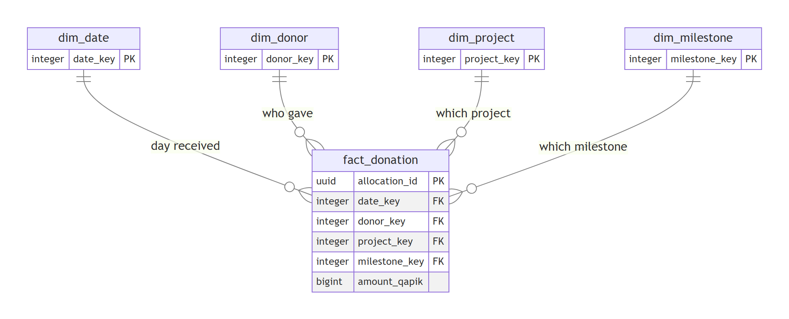</a></p>

### 11.4 Reading it

| Term | Meaning here |
|---|---|
| **Fact table** (`fact_`) | One row per event: a donation's share, a check result, a release, a ballot, a claim. Holds the numbers (measures). |
| **Dimension table** (`dim_`) | The who, what, where and when that facts are described by. |
| **Grain** | What exactly one row is. Deciding it first is the most important step; it is in the table dictionary below. |
| **Surrogate key** (`_key`) | A small number made by the warehouse. Facts join on it, so a change in the app database never breaks a join. |
| **Natural key** (`_id`) | The app's own id, kept so every row can be traced back. |
| **Degenerate dimension** | An id kept on the fact with no table of its own, for example `donation_id` (count payments with `count(DISTINCT donation_id)`). |
| **Role-playing dimension** | One dimension used twice by the same fact. `fact_release` uses `dim_date` as the day released and the day paid; `fact_claim` uses `dim_project` as the stopped project and the target project. |
| **Row 0** | Each dimension has a row with key 0 meaning *none*: the guest donor, no target project, the whole project, a date that has not happened yet. A fact's keys are therefore never empty. |
| **Type 1 history** | A changed attribute overwrites the old one. History is not lost: the app database and the chain keep it, and status changes are events in the facts. |
| **Additive measure** | Can be summed across any dimension: amounts, counts. **Non-additive**: averages and durations, such as `days_evidence_to_paid`; take a median or mean instead. |

### 11.5 Which fact uses which dimension (bus matrix)

| Fact | `dim_date` | `dim_donor` | `dim_project` | `dim_milestone` |
|---|---|---|---|---|
| `fact_donation` | received | ✓ | ✓ | ✓ |
| `fact_evidence_check` | checked | | ✓ | ✓ |
| `fact_release` | released, paid | | ✓ | ✓ |
| `fact_ballot` | voting ends | | ✓ | ✓ (0 for a stop) |
| `fact_claim` | claimed | ✓ | stopped, target | |

### 11.6 Table dictionary

| Table | Type | One row is... | Primary key | Built from |
|---|---|---|---|---|
| `dim_date` | dimension | one calendar day, in Baku time (UTC+4) | `date_key` | Generated by generate_series in star_schema.sql, 2025 to 2030. No app table. |
| `dim_donor` | dimension | one donor account; row 0 stands for every guest who gave without an account | `donor_key` | users (app database). A donor is a user with at least one donation. |
| `dim_project` | dimension | one project, with its organisation, contractor, cause and region folded in | `project_key` | projects, the published passports row (organisation, contractor, category), charities, sites (region by location). |
| `dim_milestone` | dimension | one milestone of one project; row 0 stands for 'the whole project' | `milestone_key` | milestones (app database). |
| `fact_donation` | fact | one donation's share for one milestone (an allocation in the app database) | `allocation_id` | allocations joined to donations and batches. |
| `fact_evidence_check` | fact | one of the 11 checks, run on one evidence bundle | `bundle_id, check_number` | evidence_checks joined to evidence_bundles and capture_sessions. |
| `fact_release` | fact | one release of a milestone's money from escrow to its contractor | `release_id` | releases joined to payouts, evidence_bundles, ballots. |
| `fact_ballot` | fact | one vote that donors were asked to take (one ballot) | `ballot_id` | ballots (app database), filled from the voting contract's events. |
| `fact_claim` | fact | one donor's choice for their money after a project was stopped | `claim_id` | claims (app database). |

Row 0 of each dimension, and what it stands for:

- `dim_date`: date_key 0 = 'not yet' (for example a release the bank has not paid yet); its other columns are empty.
- `dim_donor`: donor_key 0 = 'Guest': a card payment made without signing in.
- `dim_project`: project_key 0 = 'No project': the target of a claim that was a refund rather than a move.
- `dim_milestone`: milestone_key 0 = 'Whole project': used by stop votes, Passport changes and claims, which are about a project, not one milestone.

### 11.7 Column dictionary

<details>
<summary><b><code>dim_date</code></b>: The calendar. Facts point here instead of storing dates, so 'by month' or 'weekends only' is a plain filter.</summary>

| Column | Type | Role | Meaning | Comes from | Example |
|---|---|---|---|---|---|
| `date_key` | integer | primary key | The day as yyyymmdd. 0 means 'not yet'. | generated | `20261108` |
| `full_date` | date | attribute; may be empty | The day itself. Empty only on row 0. | generated | `2026-11-08` |
| `year` | smallint | attribute; may be empty | Calendar year. | full_date | `2026` |
| `quarter` | smallint | attribute; may be empty | Quarter of the year, 1 to 4. | full_date | `4` |
| `month` | smallint | attribute; may be empty | Month, 1 to 12. | full_date | `11` |
| `month_name` | text | attribute; may be empty | Month name in English. | full_date | `November` |
| `iso_week` | smallint | attribute; may be empty | ISO week number, 1 to 53. | full_date | `45` |
| `day_of_week` | smallint | attribute; may be empty | 1 = Monday ... 7 = Sunday (ISO). | full_date | `7` |
| `day_name` | text | attribute; may be empty | Day name in English. | full_date | `Sunday` |
| `is_weekend` | boolean | attribute; may be empty | Saturday or Sunday. | full_date | `True` |

</details>

<details>
<summary><b><code>dim_donor</code></b>: Who gave, without saying who they are: no name, email or phone is copied here.</summary>

| Column | Type | Role | Meaning | Comes from | Example |
|---|---|---|---|---|---|
| `donor_key` | integer | primary key | Surrogate key. 0 is the guest row. | generated | `42` |
| `donor_id` | uuid | natural key; may be empty | The account's id in the app (users.id). Pseudonymous: it identifies an account, not a person, unless joined back to the app database. | users.id | `6f1c…e2` |
| `sign_in_method` | text | attribute | How the account signs in: email (a password), google, phone (a code sent by text, in the phone app) or guest. | users.password_hash, users.firebase_uid, users.phone | `google` |
| `joined_date` | date | attribute; may be empty | The day the account was made (Baku time). Empty for guests. | users.created_at | `2026-11-02` |
| `is_guest` | boolean | attribute | True only on row 0. | generated | `False` |

</details>

<details>
<summary><b><code>dim_project</code></b>: Everything that describes a project in one row, so any fact is one join away from 'which organisation', 'which cause' or 'which region'.</summary>

| Column | Type | Role | Meaning | Comes from | Example |
|---|---|---|---|---|---|
| `project_key` | integer | primary key | Surrogate key. 0 means 'no project'. | generated | `7` |
| `project_id` | uuid | natural key; may be empty | The project's id in the app (projects.id). | projects.id | `0b3e…91` |
| `title` | text | attribute | The project's name. | projects.title | `Homes for returning families in Aghdam` |
| `status` | text | attribute | draft, published, live, stopped or completed ('none' on row 0). | projects.status | `live` |
| `goal_qapik` | bigint | attribute | The goal: the sum of its milestones' budgets. | projects.total_qapik | `18000000` |
| `milestone_count` | smallint | attribute | How many milestones the Passport has. | count of milestones | `4` |
| `published_date` | date | attribute; may be empty | The day its Passport was published (Baku time). | projects.published_at | `2026-09-14` |
| `organisation_id` | uuid | attribute; may be empty | The organisation's id in the app (charities.id). | projects.charity_id | `a41d…0c` |
| `organisation_name` | text | attribute; may be empty | The organisation's registered name. | charities.legal_name | `Bərəkət İctimai Birliyi` |
| `organisation_voen` | text | attribute; may be empty | The organisation's tax number (public). | charities.voen | `1700000011` |
| `contractor_name` | text | attribute; may be empty | The contractor the Passport names: the only company the escrow can pay. | Passport: contractor.legal_name | `Qarabağ Tikinti MMC` |
| `contractor_voen` | text | attribute; may be empty | The contractor's tax number (public). | Passport: contractor.voen | `1400000027` |
| `cause_code` | text | attribute; may be empty | The web app's cause (14 of them). | the web app's cause list, matched by Passport category and project | `housing` |
| `cause_name` | text | attribute; may be empty | The cause as shown to donors. | the web app's cause list | `Housing` |
| `passport_category` | text | attribute; may be empty | The Passport's category (8 of them); each cause belongs to one. | Passport: category | `housing` |
| `region_code` | text | attribute; may be empty | One of Azerbaijan's 14 economic regions, or a country code for work abroad. | sites.geom inside a region boundary | `karabakh` |
| `region_name` | text | attribute; may be empty | The region as shown on the map. | region boundary file | `Karabakh` |
| `country` | text | attribute; may be empty | Country where the work happens. | region boundary file | `Azerbaijan` |
| `is_abroad` | boolean | attribute | True for work outside Azerbaijan (for example Ukraine). | country | `False` |
| `escrow_address` | text | attribute; may be empty | The project's escrow contract on-chain. | projects.escrow_address | `0x5FbD…0aa3` |

</details>

<details>
<summary><b><code>dim_milestone</code></b>: The stages money is held, proven and released in.</summary>

| Column | Type | Role | Meaning | Comes from | Example |
|---|---|---|---|---|---|
| `milestone_key` | integer | primary key | Surrogate key. 0 means 'the whole project'. | generated | `31` |
| `milestone_id` | uuid | natural key; may be empty | The milestone's id in the app (milestones.id). | milestones.id | `c2a0…5d` |
| `milestone_number` | smallint | attribute | 1 for the first milestone (milestones.index + 1); 0 on row 0. | milestones.index | `2` |
| `title` | text | attribute | What will be done. | milestones.title | `Walls and roofs for 12 houses` |
| `budget_qapik` | bigint | attribute | Its budget: the sum of its budget lines. | milestones.amount_qapik | `6400000` |
| `window_opens` | date | attribute; may be empty | First day the work may be shown. | milestones.window_opens | `2026-10-01` |
| `window_closes` | date | attribute; may be empty | Last day of its window. | milestones.window_closes | `2026-12-15` |
| `status` | text | attribute | funding, evidence_submitted, checked, officer_approved, voting, approved, released, paid, rejected or stopped ('none' on row 0). | milestones.status | `voting` |

</details>

<details>
<summary><b><code>fact_donation</code></b>: Money in. A card payment split across three milestones is three rows; their sum is the payment.</summary>

| Column | Type | Role | Meaning | Comes from | Example |
|---|---|---|---|---|---|
| `allocation_id` | uuid | primary key (degenerate) | The allocation's id in the app: the leaf of the hourly Merkle tree. | allocations.id | `9e77…a1` |
| `donation_id` | uuid | degenerate dimension | The payment this share came from. count(DISTINCT donation_id) counts payments. | allocations.donation_id | `51f0…3b` |
| `date_key` | integer | foreign key → `dim_date` | The day the money was received (Baku time). | donations.created_at | `20261102` |
| `donor_key` | integer | foreign key → `dim_donor` | Who gave; 0 for a guest. | donations.user_id | `42` |
| `project_key` | integer | foreign key → `dim_project` | The project. | allocations.project_id | `7` |
| `milestone_key` | integer | foreign key → `dim_milestone` | The milestone this share funds. | allocations.project_id + milestone_index | `31` |
| `donation_kind` | text | attribute | card, pay_on_proof (a pledge charged on approval) or redirect (moved from a stopped project). | donations.kind | `card` |
| `status` | text | attribute | received, batched, in_escrow, claimed or void. | allocations.status | `in_escrow` |
| `is_anchored` | boolean | attribute | Its hourly batch is anchored on-chain. | batches.status IN (anchored, settled) | `True` |
| `amount_qapik` | bigint | measure; additive | The share, in qəpik. | allocations.amount_qapik | `2500` |

</details>

<details>
<summary><b><code>fact_evidence_check</code></b>: Proof. Every bundle of photos, video and invoices gets the same 11 checks; this table says how each went.</summary>

| Column | Type | Role | Meaning | Comes from | Example |
|---|---|---|---|---|---|
| `bundle_id` | uuid | primary key, part 1 (degenerate) | The evidence bundle's id in the app. | evidence_checks.bundle_id | `77aa…0f` |
| `check_number` | smallint | primary key, part 2 | 1 to 11, as in the check catalogue. | evidence_checks.number | `2` |
| `date_key` | integer | foreign key → `dim_date` | The day the bundle was checked. | evidence_checks.created_at | `20261105` |
| `project_key` | integer | foreign key → `dim_project` | The project. | capture_sessions.project_id | `7` |
| `milestone_key` | integer | foreign key → `dim_milestone` | The milestone the evidence is for. | capture_sessions.project_id + milestone_index | `31` |
| `attempt` | smallint | attribute | 1 for the first evidence; resubmitted evidence counts up. | capture_sessions.attempt | `1` |
| `check_name` | text | attribute | Short name: files_and_signatures, geofence, time_window, challenge_code, photo_reuse, content_credentials, deliverable, invoice, fiscal_receipt, contractor_voen, proof_checklist. | evidence_checks.name | `geofence` |
| `check_kind` | text | attribute | hard (a failure blocks the release unless the officer overrides it, with a reason) or advisory. | evidence_checks.kind | `hard` |
| `result` | text | attribute | passed, failed, advisory (noted, never blocks) or not_run. | evidence_checks.status | `passed` |
| `is_passed` | boolean | measure; non-additive (average it) | result = passed. Average it for a pass rate. | evidence_checks.status | `True` |

</details>

<details>
<summary><b><code>fact_release</code></b>: Money out. Written when the escrow releases a milestone; completed when the bank confirms it paid.</summary>

| Column | Type | Role | Meaning | Comes from | Example |
|---|---|---|---|---|---|
| `release_id` | uuid | primary key (degenerate) | The release's id in the app. | releases.id | `e0c4…19` |
| `released_date_key` | integer | foreign key (role: released) → `dim_date` | The day the escrow released the money. | releases.created_at | `20261106` |
| `paid_date_key` | integer | foreign key (role: paid) → `dim_date` | The day the bank confirmed paying the contractor; 0 until then. | payouts.updated_at where status = confirmed | `20261108` |
| `project_key` | integer | foreign key → `dim_project` | The project. | releases.project_id | `7` |
| `milestone_key` | integer | foreign key → `dim_milestone` | The milestone released. | releases.project_id + milestone_index | `31` |
| `attempt` | smallint | attribute | The evidence attempt that was approved. | releases.attempt | `1` |
| `approved_by` | text | attribute | donor_vote (turnout reached and more than half said yes) or officer_fallback (too few voted, so the officer's decision stood, as the Passport allows). | ballots.turnout_fallback | `donor_vote` |
| `released_qapik` | bigint | measure; additive | Money released, in qəpik. | releases.amount_qapik | `6400000` |
| `days_evidence_to_paid` | numeric(6,1) | measure; non-additive (average or median it); may be empty | Days from the evidence being anchored on-chain to the bank's confirmation. Empty until paid. | evidence_bundles.anchored_at, payouts.updated_at | `4.0` |

</details>

<details>
<summary><b><code>fact_ballot</code></b>: Decisions. A ballot opens after the officer approves a milestone (or to change a Passport, or to stop a project).</summary>

| Column | Type | Role | Meaning | Comes from | Example |
|---|---|---|---|---|---|
| `ballot_id` | text | primary key (degenerate) | The ballot's id on-chain, as 0x and 64 hex digits. | ballots.id | `0x3f9a…c2` |
| `end_date_key` | integer | foreign key → `dim_date` | The day voting ends (Baku time). | ballots.ends_at | `20261109` |
| `project_key` | integer | foreign key → `dim_project` | The project. | ballots.project_id | `7` |
| `milestone_key` | integer | foreign key → `dim_milestone` | The milestone voted on; 0 for a stop or a Passport change. | ballots.project_id + milestone_index | `31` |
| `ballot_kind` | text | attribute | milestone, amendment (a Passport change) or stop. | ballots.kind | `milestone` |
| `round` | smallint | attribute | Which try: the milestone's evidence attempt, or the stop proposal's number. | ballots.round | `1` |
| `eligible_count` | integer | measure; additive | Receipts that may vote: donors to that project, at the moment it opened. | ballots.eligible | `214` |
| `yes_count` | integer | measure; additive | Votes for. One receipt, one vote, if its money reaches the Passport's minimum (₼5 by default). | ballots.yes | `61` |
| `no_count` | integer | measure; additive | Votes against. | ballots.no | `9` |
| `is_passed` | boolean | attribute; may be empty | The result; empty while voting is open. | ballots.passed | `True` |
| `is_turnout_fallback` | boolean | attribute; may be empty | Too few voted (under 10% by default), so the fallback rule decided; empty while open. | ballots.turnout_fallback | `False` |

</details>

<details>
<summary><b><code>fact_claim</code></b>: The safety net. When a project stops, each donor takes a refund or moves the money to another project; doing nothing applies the default.</summary>

| Column | Type | Role | Meaning | Comes from | Example |
|---|---|---|---|---|---|
| `claim_id` | uuid | primary key (degenerate) | The claim's id in the app. | claims.id | `f81b…7e` |
| `date_key` | integer | foreign key → `dim_date` | The day the claim was made. | claims.created_at | `20261020` |
| `donor_key` | integer | foreign key → `dim_donor` | Whose money it is. | claims.user_id | `42` |
| `project_key` | integer | foreign key (role: stopped project) → `dim_project` | The project that stopped. | claims.project_id | `12` |
| `target_project_key` | integer | foreign key (role: target project) → `dim_project` | Where the money moved; 0 for a refund. | claims.target_project_id | `7` |
| `action` | text | attribute | refund or redirect. | claims.action | `redirect` |
| `is_default` | boolean | attribute | Chosen by the default rule because the donor did not choose in time. | claims.by_default | `False` |
| `status` | text | attribute | submitted, executed or failed. | claims.status | `executed` |
| `amount_qapik` | bigint | measure; additive | Money the claim covers, in qəpik. | claims.amount_qapik (sum of its allocations) | `2870` |

</details>


### 11.8 Naming conventions

| Pattern | Meaning |
|---|---|
| `dim_<thing>` | Dimension table: the who, what, where and when that facts are described by. Singular noun: dim_project, not dim_projects. |
| `fact_<event>` | Fact table: one row per business event or measurement. Named after the event: fact_donation, fact_release. |
| `<dim>_key` | Surrogate key: a small whole number made by the warehouse, the primary key of a dimension and the foreign key in facts (project_key). |
| `<thing>_id` | Natural key: the id the app database already uses (a UUID), kept so every row can be traced back (project_id). |
| `date_key`, `<role>_date_key` | A day as the number yyyymmdd (20261108). Several dates on one fact get a role prefix: released_date_key, paid_date_key. |
| `<amount>_qapik` | Money, as a whole number of qəpik (₼1 = 100 qəpik). Never a float, so totals are exact. |
| `<thing>_count` | A count, added up across rows. |
| `is_<state>` | Yes/no flag (boolean). |
| `days_<from>_to_<to>` | A duration in days, with one decimal. |
| `pk_`, `fk_`, `uq_`, `ck_`, `ix_` | Constraint and index names: pk_&lt;table&gt;, fk_&lt;table&gt;_&lt;column&gt;, uq_&lt;table&gt;_&lt;column&gt;, ck_&lt;table&gt;_&lt;rule&gt;, ix_&lt;table&gt;_&lt;column&gt;. |
| row 0 | Every dimension has a row with key 0 for 'none': the guest donor, no target project, the whole project, a date that has not happened yet. Fact keys are therefore never empty. |

### 11.9 Comments and the metafile

Every table and every column carries a database **comment**, so the documentation travels with the schema: `\d+ analytics.fact_donation` in psql, or any database tool, shows what each column means.

```sql
COMMENT ON TABLE analytics.fact_release IS 'Money out. Written when the escrow releases a milestone; completed when the bank confirms it paid. One row is one release of a milestone''s money from escrow to its contractor. ...';
COMMENT ON COLUMN analytics.fact_release.days_evidence_to_paid IS 'Days from the evidence being anchored on-chain to the bank''s confirmation. Empty until paid. Measure: non-additive (average or median it).';
```

The **metafile**, [docs/analytics/metadata.yml](docs/analytics/metadata.yml), says the same in a form tools can read, plus what a comment cannot hold: the grain and source of each table, and for each column its role, lineage (the app column it comes from), whether it is personal data and how a measure may be added up:

```yaml
  - name: "fact_release"
    type: "fact"
    grain: "one release of a milestone's money from escrow to its contractor"
    source: "releases joined to payouts, evidence_bundles, ballots."
    primary_key: ["release_id"]
    columns:
      - name: "days_evidence_to_paid"
        type: "numeric(6,1)"
        role: "measure"
        nullable: true
        measure: "non-additive (average or median it)"
        description: "Days from the evidence being anchored on-chain to the bank's confirmation. Empty until paid."
        lineage: "evidence_bundles.anchored_at, payouts.updated_at"
        pii: "none"
        example: 4.0
```

The SQL and the metafile are written from one specification, so they cannot disagree. The schema was loaded into PostgreSQL 17 and checked: 9 tables, 92 columns, 18 foreign keys and 41 CHECK constraints, a comment on every table and column, and test rows that break a rule (a refund with a target project, a zero amount, a date key that is not its date) are refused.

### 11.10 Example queries

Where the money is now, the four numbers on every dashboard:

```sql
WITH given    AS (SELECT sum(amount_qapik)   AS q FROM analytics.fact_donation WHERE donation_kind <> 'redirect'),
     released AS (SELECT sum(released_qapik) AS q FROM analytics.fact_release),
     refunded AS (SELECT sum(amount_qapik)   AS q FROM analytics.fact_claim
                  WHERE action = 'refund' AND status = 'executed')
SELECT round(given.q / 100.0, 2)                                                         AS given_azn,
       round(released.q / 100.0, 2)                                                      AS released_azn,
       round(coalesce(refunded.q, 0) / 100.0, 2)                                         AS refunded_azn,
       round((given.q - coalesce(released.q, 0) - coalesce(refunded.q, 0)) / 100.0, 2)   AS in_escrow_azn
FROM given, released, refunded;
```

Which evidence checks fail most often:

```sql
SELECT check_number, check_name, check_kind,
       count(*) FILTER (WHERE result <> 'not_run')                              AS runs,
       round(100.0 * avg(is_passed::int) FILTER (WHERE result <> 'not_run'), 1) AS pass_pct
FROM analytics.fact_evidence_check
GROUP BY check_number, check_name, check_kind
ORDER BY pass_pct, check_number;
```

More, including turnout, giving by month and cause, and how long contractors wait, are in [docs/analytics/queries.sql](docs/analytics/queries.sql).

---

## 12. Metrics

### 12.1 Product metrics

How each number in [section 4](#4-veritas-in-numbers) and on the dashboards is calculated. *Sample* values come from the web app's sample data; the formulas are the same on real data, written against the star schema.

| Metric | In plain words | Formula | Sample value | Why it matters |
|---|---|---|---|---|
| **Raised** | Money donors gave to a project | `sum(fact_donation.amount_qapik)`, without redirects counted twice | ₼1,362,360 | The headline number for donors and organisations. |
| **Funded** | How far a project is towards its goal | raised ÷ `dim_project.goal_qapik` | 73.3% | Shows which projects still need help. |
| **Released** | Money the escrow let go to contractors | `sum(fact_release.released_qapik)` | ₼490,000 (36% of raised) | Money that reached real work, only after proof. |
| **In escrow** | Money waiting for proof | given − released − refunded | ₼853,360 | Money that is safe: nobody can spend it yet. |
| **Back with donors** | Refunded or moved after a stop | `sum(fact_claim.amount_qapik)` where executed | ₼19,000 (₼13,900 refunded, ₼5,100 moved) | The safety net working. |
| **Donors** | Different people who gave | `count(DISTINCT donor_key)` over accounts, plus one per guest payment | 27,385 | Reach. |
| **Average gift** | Raised ÷ donors | | ₼49.75 | Typical donor capacity. |
| **Last 30 days** | Gifts and money in the past 30 days | `count(DISTINCT donation_id)`, `sum(amount_qapik)` over `dim_date` | 6,278 gifts, ₼323,090 | Momentum, shown on the map. |
| **Check pass rate** | Share of checks that passed | `avg(is_passed)` over checks that ran | 95.2% (157 of 165) | Quality of evidence. |
| **Clean bundles** | Bundles where every check passed | bundles with no failed hard check ÷ bundles | 84.8% (28 of 33) | How often the officer has nothing to override. |
| **Evidence to payment** | Days from evidence anchored to the bank's confirmation | median of `fact_release.days_evidence_to_paid` | 4 days (2 to 6, 19 payments) | How long a contractor waits for proven work. |
| **Turnout** | Share of eligible donors who voted | (yes + no) ÷ eligible, over closed ballots | not in the sample data | Whether donors use their say. |
| **Fallback rate** | Ballots decided by the fallback rule | ballots with `is_turnout_fallback` ÷ closed ballots | not in the sample data | If high, voting needs to be easier. |
| **Balanced days** | Days the bank, the chain and the ledger agreed | days with `reconciliations.balanced` ÷ days | runs once deployed; the tests check both outcomes | Any other answer stops releases. |

Milestones in the sample, by stage: 22 raising money, 4 fully funded, 5 with evidence submitted, 5 checked, 4 approved, 19 paid, 9 not started yet, 2 stopped (70 in all).

### 12.2 The 11 evidence checks

| # | Check | Kind | What it proves | Today |
|---|---|---|---|---|
| 1 | Files and signatures | hard | Every file's hash matches the signed manifest, signed by a registered phone key | built (app attestation next) |
| 2 | Geofence | hard | Photos and video were taken inside the site's polygon, with GPS accurate to 50 m | built |
| 3 | Time window | hard | Captured during the milestone's window and the 15-minute session | built |
| 4 | Challenge code | hard | The one-time code is visible in a photo, so the photos are fresh | next (OCR) |
| 5 | Photo reuse | hard | No photo was used before, here or in another project (perceptual hashes) | built |
| 6 | Content credentials | advisory | C2PA data and signs of an AI-made image | next |
| 7 | Deliverable | advisory | A vision model describes what is in the photos against the milestone | next (local model) |
| 8 | Invoice | hard | The invoice matches the contractor and the milestone's budget | next |
| 9 | Fiscal receipt | hard | The e-kassa receipt exists and matches | next |
| 10 | Contractor VÖEN | hard | The contractor is active in the tax registry | next |
| 11 | Proof checklist | hard | Everything the Passport asks for this milestone is there | built |

A failed **hard** check blocks the release unless the officer overrides it with a written reason. An **advisory** check never blocks; it tells the officer where to look. Checks not built yet are reported as *not run*, and the officer reviews those items by hand.

### 12.3 Decision rules (the Passport's defaults)

| Rule | Default | Allowed range |
|---|---|---|
| Voting window | 72 hours | 24 to 336 hours |
| Turnout needed | 10% of eligible receipts | 0 to 100% |
| Approval | more than 50% of votes cast | 50% to 99.99% |
| Minimum money behind a vote | ₼5 | ₼1 and up |
| Extension when turnout is low | 48 hours, once | 0 to 168 hours |
| If turnout is still low | the officer's decision stands | or: reject |

### 12.4 Security and limits

| What | Limit |
|---|---|
| Passwords | 8 to 128 characters; scrypt (N = 2¹⁵, r = 8, p = 3, about 0.25 s per try); stored with their salt, never the password |
| Wrong passwords | 10 in a row lock password sign-in for 15 minutes |
| New-password link | works once, for 30 minutes; at most 5 an hour |
| Sessions | 30 days; only the SHA-256 of the token is stored; a new password ends all others |
| Phone codes | 6 digits, 5 minutes, 5 tries, 5 an hour; only an HMAC is stored |
| Google sign-in | the ID token is verified on the server: signature, issuer, audience, expiry |
| Card webhooks | HMAC-SHA256 with a timestamp, compared in constant time; old ones refused; the payment is fetched again before it counts |
| Uploads | 20 MB per file; type checked by its first bytes, hash checked against the phone's |
| Signatures | EIP-712 for evidence, decisions, votes and claims, each by its own key |
| Assistant | 6 questions a minute and 60 a day per visitor, 2,000 model calls a day in all (per API process); questions up to 1,000 characters; it sees only a fixed description of Veritas, has no tools and no data, refuses plain prompt injections before the model, accepts its earlier replies back only with the server's signature, and withholds an answer that gives away its rules; the OpenAI key stays on the server |
| Personal data | never on-chain; documents and original photos in private storage; faces and number plates are blurred before a photo goes public, and until the detector is in, photos stay out of the public copy |

### 12.5 Engineering

| What | Number |
|---|---|
| Backend | 19,563 lines of Python; 10,252 lines of tests; **655 tests pass** (1 skipped), against PostgreSQL 17 + PostGIS and a local chain |
| API | 96 endpoints |
| Database | 41 tables (+8 mock), 4 migrations |
| Contracts | 9 contracts, 2,311 lines of Solidity; 2,919 lines of tests; **74 tests pass** |
| Web app | 20 pages; 11,740 lines of TypeScript and 5,287 of CSS; main bundle 467 KB (144 KB gzipped), Firebase loaded separately (154 KB) only for Google sign-in |
| Analytics | 9 tables, 92 columns, every one commented |
| CI | GitHub Actions for the backend (with PostGIS and Anvil), the contracts and the web app |

### 12.6 Cost on-chain

| Transaction | Gas |
|---|---|
| Hourly batch, one project | about 210,000, however many donations it holds |
| Receipt, vote, decision | 50,000 to 160,000 each |

On Polygon this is cents per transaction, and only the relayer's account needs funding.

---

## 13. Assumptions

| # | Assumption | Why it matters |
|---|---|---|
| 1 | Money is Azerbaijani manat, counted in qəpik (₼1 = 100 qəpik). | No rounding errors anywhere. |
| 2 | A licensed partner bank holds the donated money and issues vAZN, a token worth exactly ₼1, only against money it holds. | The chain moves claims on real money, not crypto. The bank's signed daily balance is checked against the chain. |
| 3 | Only registered organisations raise money, each checked once by a Veritas admin (VÖEN, documents, director). | No personal fundraisers. |
| 4 | Each project has one contractor, named in its Passport, verified by VÖEN, IBAN and the tax registry. | The escrow can pay no one else. |
| 5 | Verification Officers are independent of the organisation (for example an audit firm), registered by Veritas, and sign with their own keys. | A decision cannot be faked by the organisation or by Veritas. |
| 6 | Evidence counts only if captured through Veritas, with the one-time code, GPS and time, on a registered phone. | Old or downloaded photos cannot be passed off as new. |
| 7 | A project's region is the economic region that contains its site (Azerbaijan's 14 regions, 2021 division); work abroad is filed under its country. | The map and the region metrics. |
| 8 | Dates in reports are Baku time (UTC+4); the database stores UTC. | A donation at 23:30 in Bakı counts on that day. |
| 9 | The card provider and the bank are pretend versions in development and the demo, with the same signatures and messages as real ones would have. | The whole flow can be shown without real money. |
| 10 | The demo chain is Polygon's Amoy testnet; nothing is deployed there yet. | Real deployment is on the roadmap. |
| 11 | The web app's projects, organisations and amounts are invented sample data, labelled on every screen. Every account sees the same sample portfolio until it gives. | The demo shows full dashboards on day one. |
| 12 | The star schema is designed, documented and tested on PostgreSQL; the nightly job that fills it from the app database comes with deployment. | The metric formulas are fixed now; the numbers in section 4 come from the sample data. |
| 13 | Each donor signs with a different key for every project, kept on their own device (the phone's secure storage; in the web app, the browser, next). | Their gifts cannot be linked to each other on-chain. |
| 14 | The two projects in Ukraine are sample data in the web app. The backend's Passport accepts sites inside Azerbaijan today (a rough box that catches swapped coordinates); projects abroad need a country rule first. | The sample shows where Veritas is going, not what the backend accepts now. |
| 15 | The assistant answers only from a fixed description of Veritas (`backend/src/veritas/assistant/knowledge.py`). It can be wrong, it cannot see accounts or live figures, and it is off until `VERITAS_OPENAI_API_KEY` is set in `backend/.env`. | Visitors get quick answers without anything private being exposed. |
| 16 | Google sign-in needs the Firebase project's settings in `frontend/.env.local` and `backend/.env` (both ignored by git); email and password sign-in needs nothing external. | Sign-in works on any server, Google or not. |

---

## 14. Run it

**The quick way: Docker.** With Docker and `make`, one command runs the database, the API and the web app together, the same way as the live site:

```bash
make env    # first time only: makes .env and deploy/veritas.env with fresh secrets
make up     # builds and starts everything, on http://127.0.0.1:8110
```

`make help` lists the rest (logs, health, reseeding the demo account, a database shell). [DEPLOY.md](DEPLOY.md) walks through putting it on a server with a domain and HTTPS.

**Part by part, for development.** You need PostgreSQL 17 with PostGIS, Python 3.12 with [uv](https://docs.astral.sh/uv/), [Foundry](https://book.getfoundry.sh/) and Node.js 20+.

```bash
# backend: API, workers, tests
cd backend
uv sync
uv run alembic upgrade head
uv run python scripts/seed_demo.py         # the demo account
uv run uvicorn veritas.api.app:create_app --factory --reload
uv run pytest                               # 655 tests

# contracts
cd contracts
forge test                                  # 74 tests

# web app, on http://localhost:8080
cd frontend
npm install
npm run dev

# the analytics schema, on any PostgreSQL database
psql -f docs/analytics/star_schema.sql
```

Each part's README has the details: [backend](backend/README.md), [contracts](contracts/README.md), [frontend](frontend/README.md).

---

## 15. Stack

| Part | Choice |
|---|---|
| Web app | React 18, TypeScript, Vite, Tailwind CSS; email and password checked by our API, Google through Firebase |
| Backend | Python 3.12, FastAPI, Pydantic, SQLAlchemy 2, Alembic |
| Database | PostgreSQL 17 with PostGIS |
| Evidence checks | OpenCV, Pillow and imagehash today; Tesseract and c2pa-python next |
| AI | The assistant: an OpenAI model through the API (gpt-4.1-mini by default). Evidence review: Ollama with local vision and text models, on our own servers (next) |
| Storage | Private S3-compatible bucket; IPFS (Kubo) for public copies |
| Contracts | Solidity 0.8, OpenZeppelin 5, Foundry |
| Chain | web3.py, EIP-712 signatures, Polygon Amoy testnet for the demo |
| Tooling | uv, Ruff, pytest, GitHub Actions |

---

## 16. Repository layout

```
backend/              Python: API, workers, relayer and indexer, the mock card provider and bank
  src/veritas/        the application code
  tests/              every backend test, explained in tests/README.md
  migrations/         database migrations (Alembic)
  scripts/            the demo account, ABI export, the Python-signed contract vectors
contracts/            Solidity contracts and the deploy script
  test/               Foundry tests, explained in test/README.md
frontend/             the web app: React, TypeScript, Vite
deploy/               the server's settings template (veritas.env.example)
docker-compose.yml    database, API and web app together
Makefile              make up, make logs, make health, ...
DEPLOY.md             how the live site is deployed
docs/
  analytics/          the star schema (SQL), its metafile and the metric queries
  images/journey/     the screenshots in this README
  ROADMAP.md          what is built and what comes next
  examples/           example documents
ARCHITECTURE.md       the full design: what goes on-chain and why
```

---

## 17. Roadmap

| Phase | What | Status |
|---|---|---|
| 1 | Backend foundations: money, canonical JSON, Merkle trees, the Project Passport | Done |
| 2 | Contracts: hub, escrow, ledger, receipts, voting, payout vault | Built, tests pass |
| 3 | Database and API skeleton | Built, tests pass |
| 4 | Chain plumbing: outbox, relayer, indexer | Built, tests pass |
| 5 | Money in: card payments, hourly batches, receipts, reconciliation | Built, tests pass |
| 6 | Evidence: capture, checks, redaction, IPFS, anchoring | Built, tests pass |
| 7 | AI and documents: OCR, the vision model, e-kassa and VÖEN checks | Next |
| 8 | Decisions and payouts: officer, votes, releases, stops, refunds, redirects | Built, tests pass |
| 9 | The web app for donors, organisations and officers | Started: accounts, donor and organisation pages, the map |
| 10 | Public pieces: the verifier page, impact map, PDF receipts | Planned |
| 11 | Demo and deployment: Docker Compose, the server, Amoy, monitoring, the nightly analytics load | Planned |
| 12 | Hardening: security review, load tests, documentation | Planned |

Details and open questions are in [docs/ROADMAP.md](docs/ROADMAP.md).

---

## 18. How it scales

- **Chain cost does not grow with the number of donations.** Every donation of an hour goes into one Merkle tree, and one transaction anchors its root and the totals per milestone.
- **The API keeps no state of its own.** More API instances can run behind a load balancer; PostgreSQL holds everything. Read replicas can serve the public pages, and the busiest tables (donations, allocations, chain events) can be partitioned by time.
- **Background work scales by role.** Evidence workers share bundles safely (`SKIP LOCKED`) and can run on GPU machines once the AI checks arrive. More relayer keys mean more transactions in parallel. The indexer reads in chunks and can be split by contract.
- **Files live where files belong.** Originals stay in private object storage; public copies go to IPFS, pinned by our node and by pinning providers.
- **Reporting never slows the app.** The star schema is rebuilt from the app database and can live on a replica.
- **New money rails plug in.** The escrow holds one token and does not care which: vAZN from a partner bank today, more banks or a regulated stablecoin for donors abroad later.

---

## 19. The same building blocks elsewhere

Money held in escrow and released only against verified evidence, per-person keys that sign without revealing who signs, eligibility proven with Merkle trees, and a public, append-only record of every decision are useful well beyond donations.

| Area | How the pieces apply |
|---|---|
| **Public procurement and grants** | State contracts and grants paid by milestone against evidence and an invoice, with the decision trail public. |
| **Humanitarian aid** | Aid released when delivery is shown on site, with geofenced, time-stamped evidence. |
| **Votes with a public count** | Union, shareholder and residents' votes, participatory budgeting: eligibility by Merkle proof, one vote per key, the count on a public record. |
| **Healthcare** | Only hashes on-chain: proof that a consent form or a trial protocol existed unchanged at a given time. |
| **Environment** | Tree planting and other climate projects paid per verified, geofenced result. |

---

## 20. Team

| | Role |
|---|---|
| **Emin Bakhishli** | Full-stack and security |
| **Mahin Aliyeva** | AI engineering |
| **Avaz Asgarov** | Data engineering |
