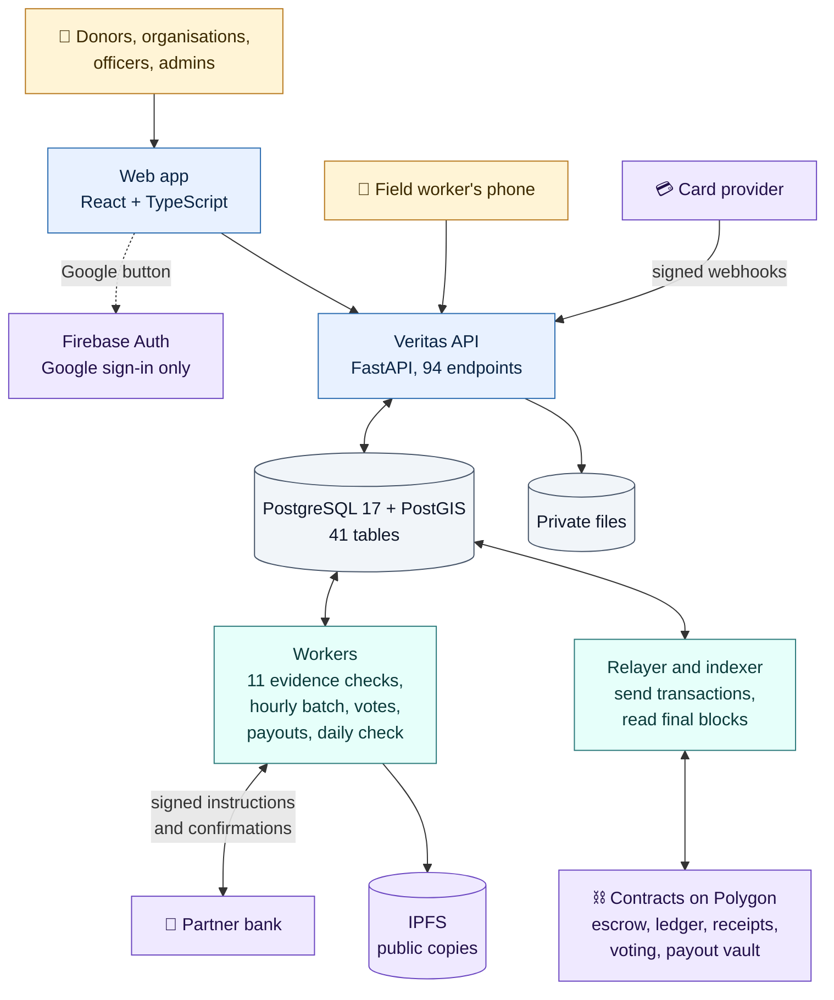

# Architecture

From the [README](../../README.md#7-architecture). GitHub draws this diagram from the source below: use its controls to zoom and pan. The README shows the same diagram as an image, [docs/images/diagrams/architecture.png](../images/diagrams/architecture.png).

