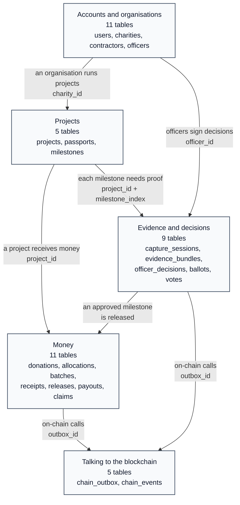

# The database's five areas

From the [README](../../README.md#103-the-whole-database-at-a-glance). GitHub draws this diagram from the source below: use its controls to zoom and pan. The README shows the same diagram as an image, [docs/images/diagrams/database-areas.png](../images/diagrams/database-areas.png).

