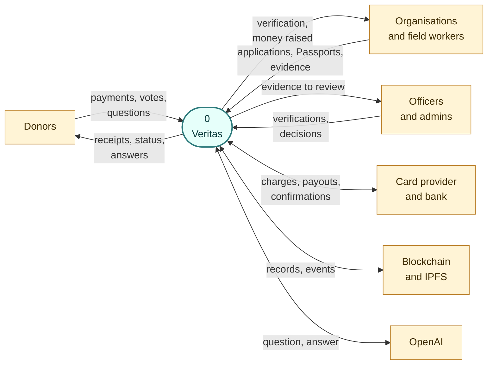

# Data flow, level 0: the context

From the [README](../../README.md#82-level-0-the-context). GitHub draws this diagram from the source below: use its controls to zoom and pan. The README shows the same diagram as an image, [docs/images/diagrams/dfd-level-0.png](../images/diagrams/dfd-level-0.png).

