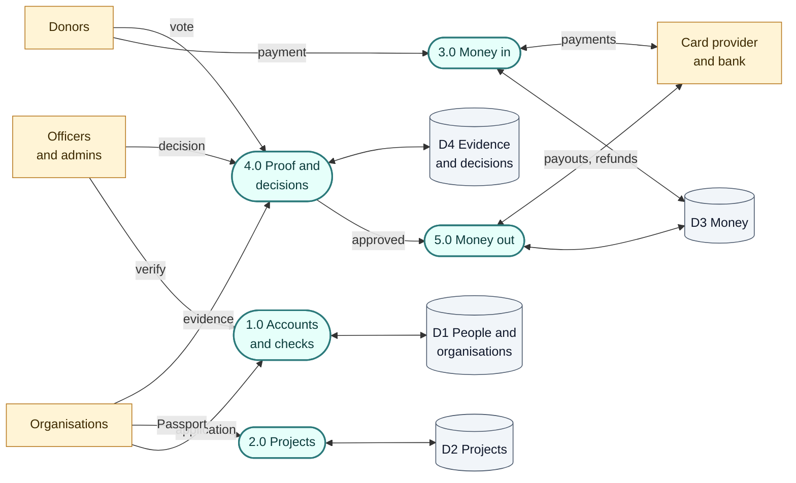

# Data flow, level 1: inside Veritas

From the [README](../../README.md#83-level-1-inside-veritas). GitHub draws this diagram from the source below: use its controls to zoom and pan. The README shows the same diagram as an image, [docs/images/diagrams/dfd-level-1.png](../images/diagrams/dfd-level-1.png).

