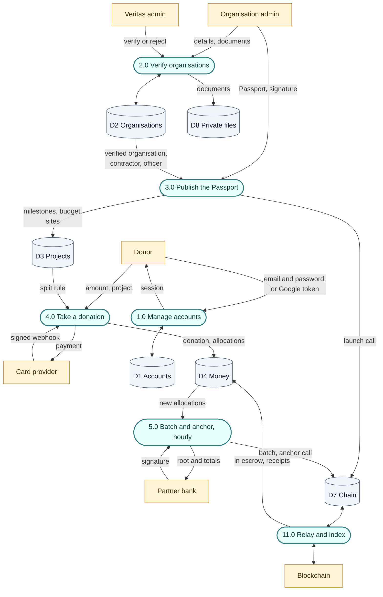

# Data flow, level 1a: setting up, and money in

From the [README](../../README.md#83-level-1a-setting-up-and-money-in). GitHub draws this diagram from the source below: use its controls to zoom and pan. The README shows the same diagram as an image, [docs/images/diagrams/dfd-level-1a.png](../images/diagrams/dfd-level-1a.png).

