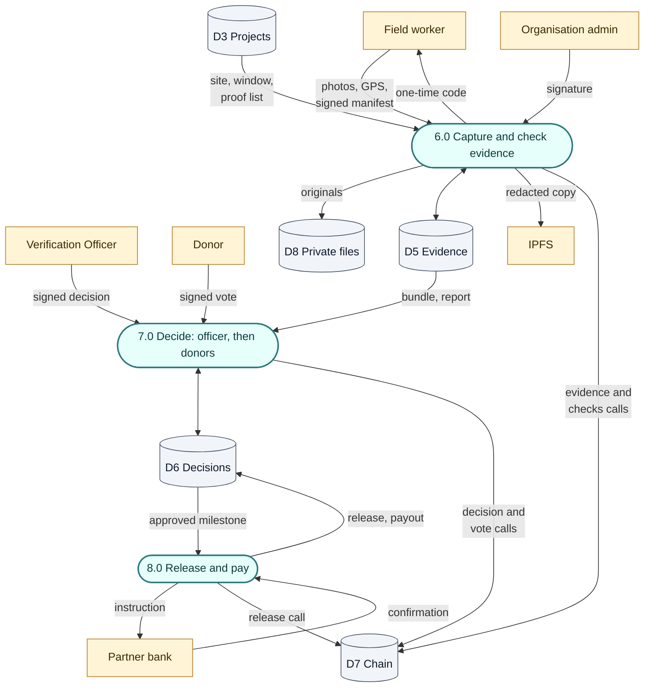

# Data flow, level 1b: proof, decisions and money out

From the [README](../../README.md#84-level-1b-proof-decisions-and-money-out). GitHub draws this diagram from the source below: use its controls to zoom and pan. The README shows the same diagram as an image, [docs/images/diagrams/dfd-level-1b.png](../images/diagrams/dfd-level-1b.png).

