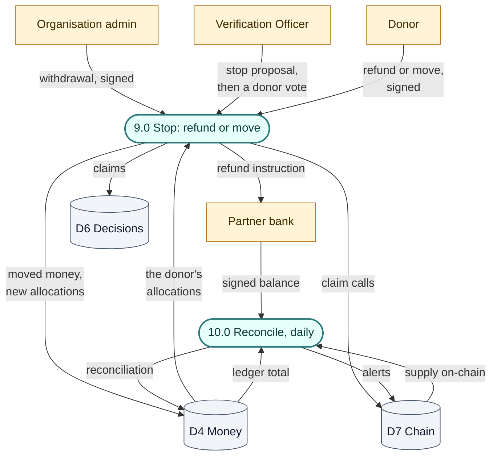

# Data flow, level 1c: when a project stops, and the daily check

From the [README](../../README.md#85-level-1c-when-a-project-stops-and-the-daily-check). GitHub draws this diagram from the source below: use its controls to zoom and pan. The README shows the same diagram as an image, [docs/images/diagrams/dfd-level-1c.png](../images/diagrams/dfd-level-1c.png).

