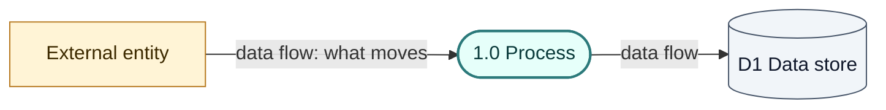

# Data flow diagram symbols

From the [README](../../README.md#81-reading-the-symbols). GitHub draws this diagram from the source below: use its controls to zoom and pan. The README shows the same diagram as an image, [docs/images/diagrams/dfd-symbols.png](../images/diagrams/dfd-symbols.png).

