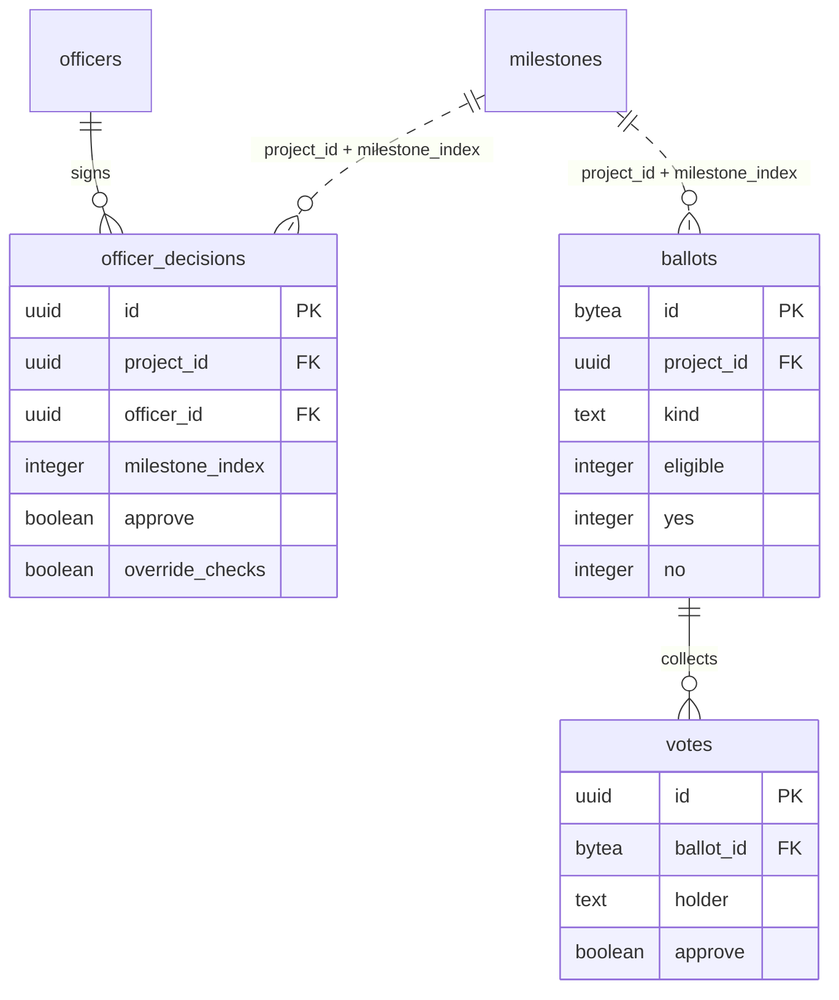

# Entity relationships: decisions

From the [README](../../README.md#104-each-area-in-full). GitHub draws this diagram from the source below: use its controls to zoom and pan. The README shows the same diagram as an image, [docs/images/diagrams/erd-decisions.png](../images/diagrams/erd-decisions.png).

