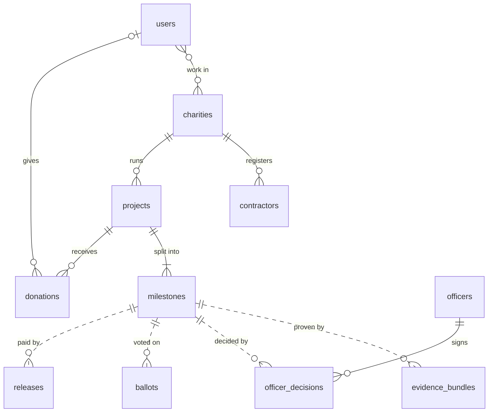

# Entity relationships: the main entities

From the [README](../../README.md#103-the-main-entities). GitHub draws this diagram from the source below: use its controls to zoom and pan. The README shows the same diagram as an image, [docs/images/diagrams/erd-overview.png](../images/diagrams/erd-overview.png).

