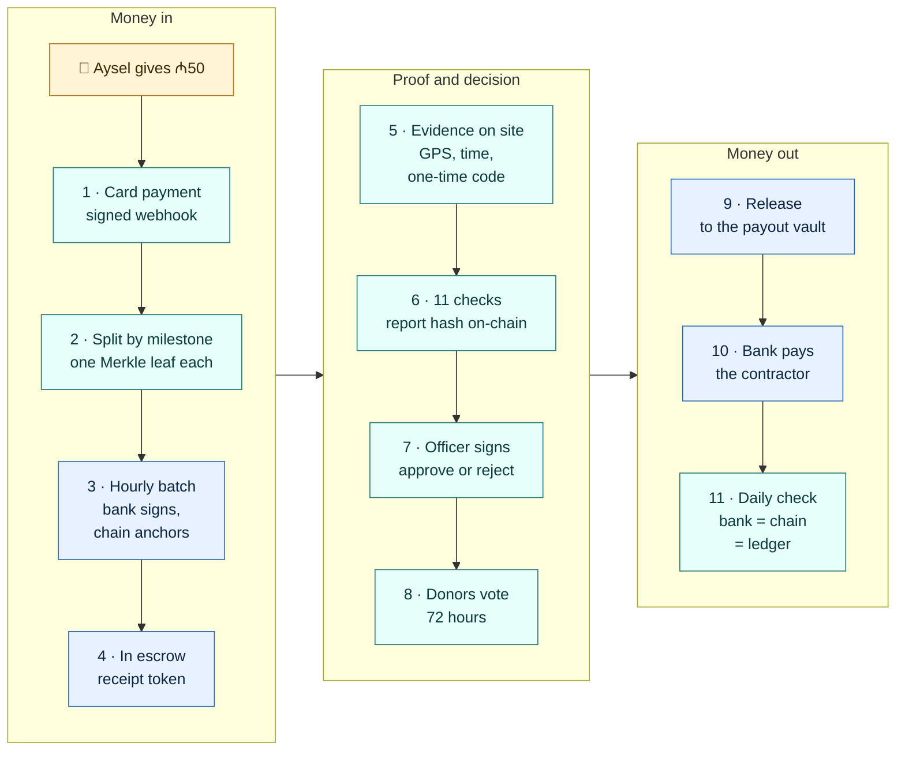

# One gift, start to finish

From the [README](../../README.md#53-behind-the-screens-one-gift-start-to-finish). GitHub draws this diagram from the source below: use its controls to zoom and pan. The README shows the same diagram as an image, [docs/images/diagrams/gift-flow.png](../images/diagrams/gift-flow.png).

