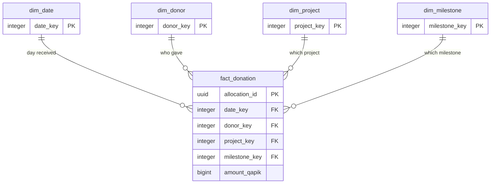

# Star schema: one star, high level

From the [README](../../README.md#113-entity-relationship-diagram). GitHub draws this diagram from the source below: use its controls to zoom and pan. The README shows the same diagram as an image, [docs/images/diagrams/star-schema.png](../images/diagrams/star-schema.png).

