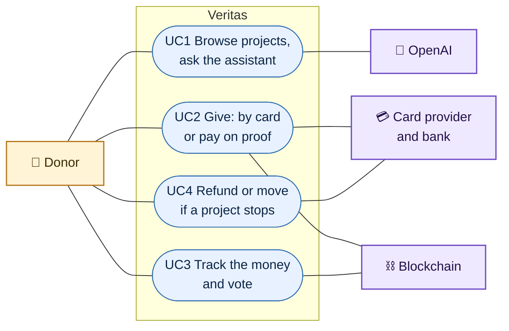

# Use cases: donors

From the [README](../../README.md#6-use-case-diagram). GitHub draws this diagram from the source below: use its controls to zoom and pan. The README shows the same diagram as an image, [docs/images/diagrams/use-cases-donors.png](../images/diagrams/use-cases-donors.png).

