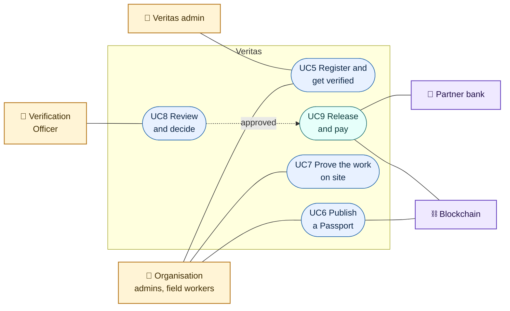

# Use cases: organisations, and the people who check them

From the [README](../../README.md#6-use-case-diagram). GitHub draws this diagram from the source below: use its controls to zoom and pan. The README shows the same diagram as an image, [docs/images/diagrams/use-cases-organisations.png](../images/diagrams/use-cases-organisations.png).

